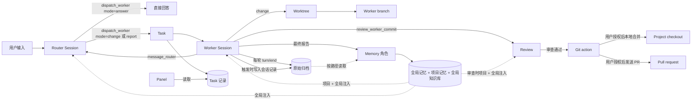

# 001 领域模型

这份文档命名 Superagent 轻量版的业务概念和每个概念守住的规则。代码、工具、面板和其余文档使用这些词。原始架构图按编号保存在 [001 术语与主流程](diagrams/001-terms-and-flow.md)、[002 预设流程](diagrams/002-preset-flow.md) 和 [003 记忆系统](diagrams/003-memory-system.md)。

## 流程

一条用户输入进入 Router Session。Router 先做一次派发决定：不需要项目工作就用 `dispatch_worker` 的 `mode=answer` 直接回答；需要查证就用 `mode=report` 让 worker 只读检查项目（可以联网检索、读取网页和查询知识库）并交回结论；需要改动项目文件就用 `mode=change` 创建 Task 并启动一个 Worker Session；用户明确授权合并已交付分支时用 `mode=merge`：没有运行中的 merge worker 就启动一个新的，有就把请求追加给同一个 merge worker，不另起 worker。change worker 在分配的 Worktree 里修改文件、提交并请求独立 Review；merge worker 先把目标分支合入自己的 Worktree 分支、提交并审查合并结果，再把 reviewed commit 本地合入 base branch；report worker 在项目 checkout 里检查，用 `report_task` 交回结论。Worker 用 `message_router` 把最终结论送回 Router。审查通过的 HEAD 等待用户授权的 Git action：本地合并写回 Project checkout，或推送分支并打开 Pull request。Task 结束后，Worktree 和 worker 分支保留到下一次恢复或交付。Router 可以用 `worker_status` 查询本会话派发的任务；排队中的 Task 被取消或排队中的 Worker 开始执行时，Router 还会收到后台状态通知。记忆独立于 Task 存在：全局记忆和全局知识库由所有项目共享，项目记忆按项目根分开；change worker 的最终报告触发 memory 角色：Host 把完整会话写入 `task/archive/sessions/` 并把可读路径和任务、角色、分支等元信息发给 memory，由 memory 自己按路径读取后更新记忆；Worker 的每一轮原始事件仍按回合归档到 `task/archive/`。

## 概念

| 概念 | 定义 | 守住的规则 |
| --- | --- | --- |
| 用户输入（Input） | 一条开启或继续回合的用户消息。 | 只有 `source.kind === 'user'` 的消息算输入；提醒使用 `superagent-lite-reminder` 来源，Worker 状态通知使用 `superagent-lite-worker-status` 来源，都不算新输入；AGENTS.md 是仓库约定，不是任务；Worker 报告和环境事件是背景（`src/turn-guard.js:54-78`、`src/worker-status.js`、`cordis.patch.yml:25-26`）。 |
| Router Session | 运行 `superagent-lite` 预设的 DSH Session。 | 每个输入先做一次决定：派发、续派，或只询问状态时用 `worker_status` 查询；不编辑项目文件；用户明确授权合并时派发 merge worker（已有运行中的就追加给它），而不是自己合并或续派原任务（`router.js`、`cordis.patch.yml:21-48`、`src/worker-status.js`）。 |
| 路由决定（Routing decision） | 当前回合内一次成功的 `dispatch_worker`、`continue_worker` 或 `worker_status` 结果。 | 一个输入一个决定；失败的工具结果不算；最多 2 次提醒重开完成回合（`src/turn-guard.js:73-108`）。 |
| Task | 一次被委派的工作及其 JSON 记录。 | 只有 `dispatch_worker` 能创建；安装 owner 可从面板停止或删除记录，删除不回收 worker 分支或 Worktree；运行中或排队中的 Task 删除前先停止并等待 worker 离开运行态；ID 是 16 位小写十六进制；固定一个 Router Session、一个 Team、一个 Project 和一个 Worker Session（`src/dispatch.js:51`、`src/task-store.js:63-83`、`src/task-store.js:107-146`）。 |
| Team | Task 归属的团队名。 | 一个 Team 只拥有一个 Project，首次写入后不得改配（`src/task-store.js:74-79`）。 |
| Project | Task 工作的项目根：Git 仓库或普通目录。 | Git 仓库派发时必须有分支被检出、工作区干净，Task 保存项目根、基础分支和基础 commit；非 Git 目录保存项目根并标记 `git: false`，不要求分支或 commit（`src/dispatch.js:61-86`）。 |
| Project checkout | Project 的主工作区，位于任何 Worktree 之外。 | report 任务在这里检查（另可使用 checkout 之外的只读检索工具）；本地合并只在这里写入；非 Git 项目没有 Worktree，change worker 也直接在这里修改（`src/report-tool.js:28-33`、`src/merge.js:28-55`、`index.js`）。 |
| Worker Session | 执行一个 Task 的 DSH Session，运行 `superagent-lite-worker` 预设。 | 从项目根启动；Git 项目除 `create_worktree` 和只读的 `knowledge_query` / `knowledge_get` 外的工具要求工作目录在分配的 Worktree；非 Git 项目工作目录直接是项目根，不注册可用的 `create_worktree`；subagent 结束时冻结；面板停止会中断当前执行但不删除 Session（`index.js:92-236`、`src/worker-control.js:5-20`）。 |
| Worktree | worktree 服务为一个 Git Task 创建的隔离检出。 | 一个 Git Task 一个 Worktree，位于 `<project>/.agents/worktrees`，名字为 `sl-<worktreeName>-<Task ID 前 12 位>`；`worktreeName` 是 1–4 个英文小写短词；文件与其他 Task 分开；它不是操作系统安全边界；非 Git 项目没有 Worktree。面板的「分支 / worktree」标签页只列这些 Worktree 和 `sl-*` 分支，允许安装 owner 分开删除工作树与分支（`cordis.patch.yml:1-7`、`src/worktree-tool.js:42-46`、`src/branches-panel.js:15-68`、`src/git-actions.js:603-701`、`src/merge.js:175-216`）。 |
| Worker branch | Worktree 所在的分支。 | 仅 Git 项目有；分支名取自 worktree 服务的返回值并写入 `task.worktree.branch`；只有审查过的 HEAD 会被合并或发布（`src/worktree-tool.js:40-49`、`src/git-actions.js:170-181`）。 |
| Review | 独立子代理对已提交 diff 或非 Git 工作区内容的裁决。 | Reviewer 用 `submit_review` 记录裁决：内容「通过」即通过，其他内容记为审查意见；工具记录 reviewed HEAD 或工作区标识与 reviewer Session；裁决针对 Task 保存的需求，follow-up 只作上下文；审查本身不改 Task 状态；审查请求可以附带 worker 指定的本地图片（`src/review.js:17-39`、`src/review.js:91-167`、`src/review.js:170-189`）。 |
| Report | Worker 通过 `message_router` 发给 Router 的最终结论。 | 1–4,000 字符；只发一次，不发过程进度；可附带 worker 当前目录下的本地图片，图片作为消息内容跟在文本后；文本不写 Task 状态，状态由生命周期事件写（`src/message-router.js:16-24`、`src/message-router.js:4-29`）。 |
| Follow-up | 对同一未发布 Task 的补充或修正。 | 只有目标 Deliverable 相同时用 `continue_worker`；记录在 `task.followUps`；可附带本地图片，发送失败时回滚记录、不留下半条消息；尚未启动的 Task 返回「稍后再试」而不投递（`src/continue.js:242-285`、`src/continue.js:216-296`）。 |
| Worker status | Router 查询本会话 Worker 和 Task 状态的工具与后台通知。 | `worker_status` 只返回本 Router Session 派发的任务，按 `queued`、`running`、`delivered`、`cancelled`、`failed` 分组，并给出 Task ID、标题、Team、模式和 Worker Session；停止后的 Task 保留 `cancelled` 记录，任务停止和排队 Worker 开始会向 Router 注入背景通知，不打开新回合、不算新输入（`src/worker-status.js`、`src/task-store.js`、`src/launch-queue.js`）。 |
| 只报告任务（Report-only task） | `mode=report` 的 Task，只做诊断、分析、查找或只读检查，可联网检索和读取网页。 | 不建 Worktree、不提交、不审查；结束时调用 `report_task`，可附带本地图片；Git 项目的 checkout 必须保持原样，非 Git 项目没有 git 事实可校验。worker 按仓库 `AGENTS.md` 的约定执行，但该约定不扩大只读授权（`index.js:177-196`、`src/report-tool.js:21-44`、`src/worker-prompt.js:37-63`）。 |
| Git action | 面板发起的 `merge`、`publish`、`review` 或 `delete-branch`；用户直接指示的 `merge` 由 router 派发 `mode=merge` 的 merge worker 执行。 | 合并只在用户明确授权后执行，始终是把 reviewed HEAD 合入所选本地分支的本地合并，不需要 `gh`；merge worker 合入的是它自己的 reviewed merge commit，这些目标分支的提交因此进入 base branch。`publish` 需要用户点击、`gh` 账号和所选 GitHub remote，推送 reviewed HEAD 并创建或复用 Pull request；`review` 从 Worker Session 启动独立审查；`delete-branch` 删除仍是 worker 分支的分支及其干净 Worktree，已合并、已发布和未合并的分支都可删除，运行中、工作树脏或被其他 Worktree 检出时拒绝。合并与发送 PR 共用状态、审查和 HEAD 校验（`src/delivery.js:7-19`），发送 PR 只额外要求 GitHub 账号与 remote；合并、发送 PR 和删除分支要求 full access，合并与发送 PR 还要求未移动的 reviewed HEAD（`src/git-actions.js:504-523`、`src/merge.js:121-170`）。 |
| Pull request | GitHub 上承载已发布 Task 的检查与合并界面。 | PR 的 HEAD、head 分支、base 分支和跨仓库标记必须与 Task 完全一致；必需检查和分支保护在合并 PR 时由 GitHub 执行（`src/github.js:26-40`、`src/github.js:91-98`）。 |
| Memory | 分全局记忆、项目记忆、全局/项目 skill 和全局知识库。 | 全局记忆所有项目共享，保存用户画像和多个共享 skill；项目记忆按项目根分开，保存职责、定位和最多 10 个项目 skill；知识库是全局的，所有项目共用，存知识、事实、经验、结论，skill 只存可复用的固定流程或方法步骤。Router 只注入全局记忆；Worker 和 Reviewer 注入项目 + 全局。记忆是数据，不是指令；面板的「记忆系统」标签页展示全局记忆、项目记忆、全局/项目 skill 和全局知识库，安装 owner 可删除单条记忆字段、skill 或知识（`src/memory.js`、`src/memory-store.js`、`src/memory-panel.js`、`router.js`、`src/review.js`）。 |
| Memory 角色（Memory role） | 按归档路径读取 Worker 会话并更新记忆的只读 helper 子代理。 | 只由 change 任务的最终 `message_router` 报告触发一次；触发消息只含会话记录的可读路径和任务、角色、分支、Session、项目根等元信息、项目 skill 已用数量与 10 个上限，以及每条 skill 的名称和作者（`author: memory` 或 `none`），不含对话正文，memory 自己用 `read` / `grep` 读取；不接收 worker 提交的摘要；技能只通过会话里的 skill catalog 获知 description，触发消息不写 skill 路径、description 或正文；需要正文时按名调用 `skill` 工具，也不用 read/glob/grep 翻 skill 目录；字段用空字符串表示保持不变，skill 用空数组表示该作用域不变；只写回发生变化的字段和 skill；可以不加记忆，不把写入条数当指标；项目 skill 达到 10 个上限后不能新建，只能复用已有名字更新，写入路径拒绝并报错，整次提取不写任何字段或 skill；知识、事实、经验、结论写知识库，skill 只写固定流程；可用 `knowledge_query`、`knowledge_get` 和 `knowledge_write`，且只有它能写知识（`src/memory.js`、`src/helper-guard.js`、`src/message-router.js`、`index.js`）。 |
| Skill | 全局或项目级的可复用指令，每个 skill 一个名字、一个独立目录。 | 只放可复用的固定流程或方法步骤，知识、事实、经验、结论和观察不写成 skill。全局 skill 在 `~/.agents/skills/<skill名>/SKILL.md`；项目 skill 在 `<项目根>/.dsh/skills/<skill名>/SKILL.md`，由 Worker 作用域的 provider 从项目 checkout 读取，Worker、Reviewer 和 memory 角色可见，Router 不可见；只有 description 进入 skill catalog，完整内容按需用 `skill` 工具加载。项目 skill 同时最多 10 个；达到上限后 memory 不能新建，只能复用已有 memory 管理的名字更新。memory 写入的 skill 在 frontmatter 带 `author: memory`；不同内容使用不同名字和目录，同名冲突不覆盖非 memory 管理的 skill。既有的 `superagent-shared-memory` 和 `superagent-project-memory` 继续可用，下次写入时补 author。新增、修改或删除的 skill 都由作者判断归属：全部是 memory 作者时只对之后派发的会话发布，不惊动已运行/已结束会话；作者缺失按普通 skill 处理（`src/memory-store.js`、`src/memory.js`、`src/skill-catalog.js`、`index.js`）。 |
| 知识库（Knowledge base） | 全局的、只通过工具访问的长期结论集合。 | 只存可复用、广泛适用的知识，保存在 `~/.dsh/superagent-lite/memory/knowledge.json`；内容不注入角色上下文；Worker、Reviewer 和 memory 角色用 `knowledge_query` 按关键词查询：英文按单词、中文按相邻两字切分，多词查询按命中的关键词数量排序，单个关键词仍按子串匹配，得到编号和匹配关键词前后的上下文片段，再用 `knowledge_get` 按编号读取完整条目；只有 memory 角色能用 `knowledge_write` 新增、纠正或删除（`src/memory-store.js`、`src/memory.js`）。 |
| 原始归档（Raw archive） | Worker 完整回合的原始记录和 memory 读取的会话记录。 | 每个 `turn/end` 把一轮事件存到 `~/.dsh/superagent-lite/task/archive/<hash>.json`，带 Session 序号和轮内 `reference` 编号；memory 触发时再把完整会话写成 `task/archive/sessions/<sha256(Session ID)>.md`，路径随触发消息交给 memory；都由 Host 写入，其他模型工具没有专用读取入口，Git 与非 Git 项目走同一位置（`src/memory.js`、`src/memory-store.js`）。 |
| Role message | 角色消息、子代理状态通知和插件系统提醒在聊天里的卡片。 | 角色间消息（`agent-message`，含派发任务、worker 报告、follow-up、reviewer 审查请求和 memory 蒸馏请求）、子代理结束通知（`subagent-settled`）和插件自有通知（`superagent-lite-*`，当前是派发守卫提醒）在应用 Host 补丁后统一渲染为任务消息卡片，包括被 steer 进运行中回合的消息；没有补丁时按普通用户消息或上下文行显示。npm Host 升级覆盖包后，插件启动时会自动补打两个补丁并在 Host 日志要求再重启一次；桌面版和只读安装无法写入补丁，项目任务面板会显示只读提示。`0.2.3-alpha.1` 的子代理已原生记录初始任务，只补客户端。覆盖版本为 `0.2.2-rc.1` 到 `0.2.3-alpha.1`；DSH-go 仍手动应用。审查和记忆 helper 的结果通过工具结果返回，不是会话消息（`docs/HOST-PATCH.md`、`docs/HOST-PATCH-AGENT-MESSAGE.md`、`src/host-patch.js`）。 |
| Worker 设置 | 面板「设置」标签页保存的 worker 默认值和并发上限。 | 只允许安装 owner 读写；worker 模型留空时跟随 DSH 默认模型；并发上限约束新启动的 worker，超出的 Task 排队且可停止；review 不占 worker 名额，但和 worker 一起计入 Host 的 `maxActiveSubagents`，Host 名额满时 Task 也退回排队；设置只影响之后启动的 worker（`src/worker-settings.js`、`src/settings-panel.js`、`src/launch-queue.js`、`src/subagent-capacity.js`）。 |
| Panel | Web 侧的「项目任务」面板。 | 只允许安装 owner 读取和删除记忆；任务列表是唯一状态分类来源，面板状态由任务、分支和审查事实推导，可按六个面板状态分组过滤并单独筛出排队中的 Task；合并、发送 PR、审查、删除分支、停止任务和删除任务记录都是任务行内的动作；任务行可勾选后批量删除；面板只读任务；「设置」标签页保存 worker 模型与并发上限；「记忆系统」标签页可本地搜索并展示记忆、全局/项目 skill 和知识库，并允许 owner 删除单条记忆字段、memory 管理的 skill 或知识条目；「分支 / worktree」标签页只列本插件创建的 Worktree 和 `sl-*` 分支，沿用任务已有状态，并允许 owner 分别删除 Worktree 与分支（`src/board.js:16-154`、`src/status.js:14-53`、`src/memory-panel.js`、`src/branches-panel.js:15-68`、`client.js:382-1576`）。 |

## 聚合

Task 是唯一聚合根。它持有：

| 字段 | 内容 |
| --- | --- |
| `id`、`title`、`teamId`、`task`、`mode` | 标识、显示标题、Team、保存的需求文本、`change`、`report` 或 `merge`（`answer` 不建 Task） |
| `worktreeName` | change 与 merge 任务的英文短名，组成 Worktree 和 worker 分支名；只由路由派发时写入 |
| `parentSessionId` | 发起派发的 Router Session |
| `projectRoot`、`baseCommit`、`baseBranch` | 项目根、worker 起点 commit、基础分支；非 Git 项目保存 `git: false`，不写后两项 |
| `git` | 可选；`false` 表示项目根不属于任何 Git 仓库，任务直接在工作区执行且没有分支/Worktree |
| `workerSessionId` | 唯一的 Worker Session |
| `status` | 状态枚举中的一个值 |
| `worktree` | `path`、`branch`、`baseCommit`、`repositoryRoot`、`sourceBranch` |
| `review` | `head`、`reviewerSessionId`、`approved` |
| `mergeTarget`、`mergeBranches`、`branchDeletedAt` | 本地合并的目标分支、merge 任务要合入 worktree 分支的目标分支列表，以及 worker 分支被删除的时间 |
| `followUps` | 追加要求条目，含 `id`、`text`、`at` |
| `report` | 只报告任务的结论与时间 |
| `prUrl`、`prState` | 已发布 Pull request 的地址与状态 |
| `failure` | 最近一次派发或交付错误 |
| `stopReason`、`finishedAt`、`createdAt`、`updatedAt` | 结束原因与时间 |

Router Session、Worker Session、Reviewer 和 memory 角色都是 DSH Session，不是 Task 字段；Task 只保存它们的 ID。GitHub、`gh` 和 worktree 服务是外部系统，通过 Host 服务与 Git 命令接入，不进入领域模型。

## 术语

| 术语 | 中文 | 含义 |
| --- | --- | --- |
| Input | 输入 | 开启或继续回合的用户消息 |
| Router | 路由器 | 决定谁来工作的 Session |
| Router Session | 路由会话 | 运行 `superagent-lite` 预设的 Session |
| Routing decision | 路由决定 | 当前回合内一次成功的派发、续派或状态查询工具结果 |
| Worker | 执行者 | 执行一个 Task 的 Session |
| Worker Session | 执行会话 | 运行 `superagent-lite-worker` 预设的 Session |
| Task | 任务 | 一次委派的工作及其记录 |
| Team | 团队 | Task 归属的团队名 |
| Project | 项目 | Task 工作的项目根（Git 仓库或普通目录） |
| Project checkout | 项目工作区 | 主工作区，位于 Worktree 之外；非 Git 项目也是 change 工作区 |
| Worktree | 工作树 | 一个 Git Task 的隔离检出 |
| Worker branch | worker 分支 | Worktree 所在的分支；非 Git 项目没有 |
| Review | 审查 | 对已提交 diff 或非 Git 工作区内容的只读裁决 |
| Report | 报告 | Worker 发给 Router 的最终结论 |
| Follow-up | 追加要求 | 对同一未发布 Task 的补充或修正 |
| Report-only task | 只报告任务 | 不修改项目的 Task |
| Git action | Git 操作 | 合并、发送 PR、审查或删除分支 |
| Pull request | 拉取请求 | GitHub 上的发布与合并界面 |
| Role message | 角色消息 | 角色之间和系统通知的聊天卡片 |
| Panel | 面板 | Web 侧「项目任务」界面 |
| Worker settings | Worker 设置 | 面板保存的 worker 模型与并发上限 |
| Worker status | Worker 状态 | Router 查询的排队、运行、交付、取消和失败任务视图 |

## 枚举值

Task 记录只保存一个生命周期状态。下表的生命周期值都有写入路径；`unconfirmed` 不是状态，而是面板给失联的运行中 Task 加的标签。六个面板状态是另一套在读取时推导的枚举（`src/status.js:14-53`）。

| 组 | 取值 | 含义 |
| --- | --- | --- |
| 派发 | `queued` | 记录已创建，等待插件 worker 名额或 Host 子代理名额后再启动 Worker；尚未开始执行时可以停止，停止后记录保留为 `cancelled`，不会再启动（`src/dispatch.js:68-86`、`src/launch-queue.js`、`src/task-store.js:126-146`） |
| 派发 | `starting` | 记录已创建，Worker 正在启动；Host 报 `ACTIVATION_LIMIT_REACHED` 时退回 `queued` 等待下一次队列检查，不记为失败（`src/dispatch.js:68-86`、`src/launch-queue.js`、`src/subagent-capacity.js`） |
| 工作 | `running` | Worker 已创建，或 Git 项目的 Worktree 已保存，任务进行中；非 Git 项目在 Worker 创建后即为工作目录（`index.js:120-127`、`src/worktree-tool.js:49`） |
| 工作 | `resuming` | 已结束或在恢复中的 Task 被 follow-up 重新打开（`src/continue.js:265-276`） |
| 审查 | `review-required` | Worker 结束时没有通过的审查，或审查后 HEAD 又移动（`index.js:262-308`） |
| 交付 | `awaiting-merge` | 审查过的 HEAD 等待用户授权的交付动作；失联的 `running` 记录在 Review 通过、分支存在且 Worktree HEAD 仍等于 reviewed HEAD 时也回收到这里（`index.js:300`、`src/git-actions.js:293-304`、`src/launch-queue.js:54-120`） |
| 交付 | `merging` | 面板或命令触发的本地合并已开始（`src/merge.js:64-68`） |
| 交付 | `publishing` | 发送 PR 的路径已开始（`src/git-actions.js:442-446`、`src/git-actions.js:478-480`） |
| 交付 | `awaiting-ci` | reviewed HEAD 的 PR 已打开；面板读取时用 `gh` 同步 PR 状态（`src/github.js:64-99`、`src/git-actions.js:280-285`） |
| 交付 | `merged` | 提交已进入基础分支：本地合并、外部合并 PR，或面板读取时确认已包含在基础分支（`src/merge.js:85-87`、`src/git-actions.js:311-319`） |
| 交付 | `delivery-blocked` | 发送或合并失败，或精确匹配的 PR 被关闭（`index.js:301-303`、`src/git-actions.js:275-279`、`src/merge.js:81-82`） |
| 结束 | `completed` | 只报告任务通过 `report_task` 交付了结论，或非 Git 的 change 任务在审查通过后结束（`src/report-tool.js:36-42`、`index.js`） |
| 结束 | `failed` | 派发、Worker 回合或 follow-up 发送失败，或失联的 `starting`/`running`/`resuming` 被启动扫描或队列回收且没有可交付的 reviewed HEAD（`src/dispatch.js:105-113`、`index.js:271-292`、`src/continue.js:286-293`、`src/launch-queue.js:54-120`） |
| 结束 | `cancelled` | 安装 owner 在面板停止运行中或排队中的 Task；worker 被中断，并发名额立即释放，记录保留在面板并归入「失败」分组（`src/worker-stop.js:6-29`、`src/task-store.js:126-146`） |

删除 worker 分支不新增生命周期状态：Task 保留原状态，只记录 `branchDeletedAt` 并清空 `worktree`；面板把非失败的此类 Task 显示为已完成，失败 Task 保持失败（`src/merge.js:121-170`、`src/git-actions.js:290-295`）。

面板字典还识别 `ready`、`merge-queued`、`merge-conflict`、`interrupted`、`cancelled` 这些文案；新的停止路径写入 `cancelled` 终态并保留活动记录，面板把它归入「失败」分组并加「已取消」标签。它不同于 `failed`（worker/回合失败）和 `delivery-blocked`/`merge-conflict`（自动交付阻塞），表示用户主动停止，不会自动恢复。旧版本排队取消留下的 `cancelled` 墓碑仍可被 `worker_status` 查询，但面板不显示（`client.js:14-15`、`client.js:14-15`、`src/status.js:8-10`、`src/task-store.js`）。

## 面板状态

面板从存储状态、worker 分支、审查记录和 Pull request 事实推导出一套独立的六值状态，不写回 Task 记录；推导顺序由 003 生命周期定义。

| 面板状态 | 含义 |
| --- | --- |
| `unmerged` / 未合并 | 当前 worker HEAD 已审查通过且尚未合并；用户可以合并或发送 PR |
| `running` / 运行中 | Worker、排队中的 Worker 或交付动作正在进行 |
| `unreviewed` / 未审查 | worker 分支有提交，但当前 HEAD 没有通过的审查 |
| `completed` / 已完成 | reviewed HEAD 已合并，或 Worker 结束时没有可交付的提交 |
| `failed` / 失败 | Worker 回合、交付动作或 Task 失败；带「已取消」标签的行表示用户停止，不是失败 |
| `answer` / 仅回答 | report 任务交回了报告 |

派发模式有三个值；`answer` 不产生 Task。

| 模式 | 取值 | 含义 |
| --- | --- | --- |
| 派发模式 | `change` | Worker 修改项目文件、提交并请求审查；写入 Task 的 `mode` |
| 派发模式 | `report` | Worker 在项目 checkout 只读检查，可联网检索，不提交，以 `report_task` 结束；写入 Task 的 `mode` |
| 派发模式 | `answer` | Router 直接回答；不启动 Worker、不建 Worktree、不写 Task 记录 |

## 图表对齐

[diagrams](diagrams/) 里的原图是术语和流程的参照。实现与图不一致的地方列在下表；代码和其余文档按实现写。

| 原图规则 | 实现 |
| --- | --- |
| Router 每轮处理一个「调用 worker」工具，可以不调用，但要写明为什么 | 派发守卫要求每个用户输入有一次成功的 `dispatch_worker` 或 `continue_worker`；`mode=answer` 的成功结果就是不派 worker 的决定，没有决定的完成回合会被提醒（`src/turn-guard.js:73-127`）。 |
| 同一业务的补充在业务面板添新业务，再派 worker | 实现用 `continue_worker` 继续同一个未发布 Task，不新增第二行；不同业务目标或已发布的 Task 新建 Task 和 Worker（`src/continue.js:218`、`src/continue.js:216-231`）。 |
| Worker 处理完毕，结果返回 Router，能力冻结，业务算已完成 | change worker 结束后进入审查和交付，落为 `review-required`、`awaiting-merge`、`failed` 或 `delivery-blocked`；只有 report 任务在 `report_task` 后到 `completed`（`index.js:262-308`、`src/report-tool.js:36-42`）。 |
| 若干 worker 组成团队，一个项目通常由一个团队管理，不同项目由 Router 分开 | 相同；第一个 Task 固定 Team 与 Project 的一对一关系，之后不能改配（`src/task-store.js:74-79`）。 |
| Router 只被注入全局记忆 | Router 的运行时上下文只读取全局记忆；router 预设的 skill 根也只保留全局 skill 根，项目 skill 只进入 Worker 和 Reviewer 的 catalog（`src/memory.js`、`router.js`、`cordis.patch.yml`）。 |
| Worker 和 Reviewer 注入项目记忆 + 全局记忆 | Worker 创建时和 Reviewer 每次审查时读取项目 + 全局记忆；职责和定位直接注入，skill 只注入 description，知识库内容不注入，通过 `knowledge_query` / `knowledge_get` 按需查询（`src/memory.js`、`src/review.js`）。 |
| memory 角色可读可写，宁可不写并及时纠错 | 只写回非空且变化的字段和 skill，没有可复用内容就不写，不把写入条数当指标；项目 skill 最多 10 个，达到上限后只能复用已有名字更新，不能新建，超限写入被拒绝且不产生半写入；知识库写入按规范化文本去重，纠正用 `update`，删除用 `delete`（`src/memory.js`、`src/memory-store.js`）。 |
| 不同项目的记忆分开 | 项目记忆和项目 skill 按项目根隔离；全局记忆、全局 skill 和知识库所有项目共享（`src/memory-store.js`）。 |
