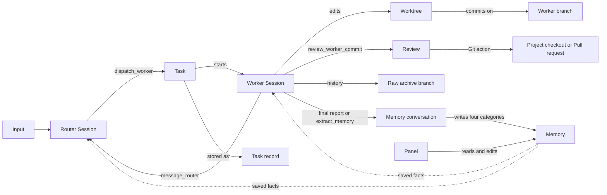

# 001 Domain model

This document names the concepts the project works with and the rules each one keeps. The code, the tools, the panel and the other documents use these terms and no others. It is the first document in the series. The raw architecture diagrams are preserved in order: [001 terms and main flow](diagrams/001-terms-and-flow.md), [002 preset flow](diagrams/002-preset-flow.md) and [003 memory system](diagrams/003-memory-system.md).

## Flow

A person's input reaches the Router Session. The router makes one routing decision: `dispatch_worker` starts a Task for a Team in a Project, or the router answers without a worker. The Task gets one Worker Session that works in an isolated Worktree of the Project checkout. The worker commits on its Worker branch and requests a Review. The worker's Report goes back to the router, and a reviewed branch waits for the user's explicit Git authorization: merge into the base branch or publish a Pull request. Memory outlives a Task; a Task message carries a follow-up or a report between the two Sessions. The worker history branch keeps every turn with numbered references, while the memory conversation extracts useful facts into four categories: private, public knowledge, user profile and environment, and team knowledge. The owner can read, edit and delete saved memory in the panel.

## Concepts

| Concept | Definition | Rules it keeps |
| --- | --- | --- |
| Input | One user message that opens or continues a turn. | Only a user-role message from the person counts. Repository text, timestamps, notices, worker reports and reminders are background. Each input needs one routing decision. |
| Router Session | The DSH Session running the `superagent-lite` preset. | Makes one routing call per input. Starts workers, edits no project files, pushes nothing, and merges only after explicit user authorization. |
| Routing decision | A successful `dispatch_worker` or `continue_worker` call in the input's turn. | One input, one decision. A failed call does not count. At most 2 reminders reopen a completed turn that lacks a decision. |
| Task | A unit of delegated work stored as one JSON record. | Only `dispatch_worker` creates one. It belongs to one Router Session, one Team and one Project. Its ID is 16 lowercase hexadecimal characters. |
| Team | The name a Task is assigned to. | One Team owns one Project; the pair cannot change after the first task. Team memory is scoped by team and project. |
| Project | The Git checkout a Task works on. | It must have a branch checked out and a clean working tree at dispatch. The Task stores the project root, base branch and base commit. |
| Project checkout | The main working copy of the Project, outside any Worktree. | A report-only task inspects it in place. A local merge writes to it only when the task and the target pass the merge checks. |
| Worker Session | The DSH Session that executes one Task, started with the `superagent-lite-worker` preset. | It starts in the project root, must create or enter its Worktree before any other tool, and freezes when its subagent ends. |
| Worktree | An isolated checkout that the worktree service creates for one Task. | One per Task, under `<project>/.agents/worktrees` with an `sl-` name prefix. Files stay separate from other tasks. It is not an OS security boundary. |
| Worker branch | The Git branch the Worktree is on. | Named `sl-<team>-<taskId>`. It holds the task's commits. Only the reviewed commit is merged or published. |
| Review | A read-only subagent verdict on the committed diff. | It approves or blocks, and records the reviewed commit and the reviewer session. The reviewer records the verdict with `submit_review`; its content `通过` approves, anything else is a finding. Approval is judged against the Task's stored requirements; follow-ups are context only. |
| Report | The worker's final message to the router. | One conclusion: `COMPLETED`, `INCOMPLETE` or `BLOCKED`. It carries no routine progress. The `message_router` text does not set the Task status; lifecycle events do. |
| Follow-up | An input that adds to or corrects an unpublished Task. | `continue_worker` delivers it while the worker runs or after it goes idle. It is recorded on the Task and passed to the reviewer as context. A different goal is new work. |
| Report-only task | A Task that answers a diagnosis, analysis, lookup or read-only inspection. | Created with `mode=report`. It inspects the project checkout read-only, creates no Worktree or branch, commits nothing, requests no Review and ends with `report_task`. |
| Git action | A `merge`, `publish`, `review` or `delete-branch` request from the panel; `merge` also comes from a direct user instruction or `/merge-worker`. | A merge needs explicit user authorization and is always a local merge of the reviewed head into the chosen local branch; it uses no GitHub account. `publish` needs the user's panel action, a `gh` account and a chosen GitHub remote, then pushes the reviewed head and opens or adopts a Pull request. `review` starts the independent reviewer from the worker Session. `delete-branch` removes a merged worker branch and its Worktree. |
| Pull request | The GitHub review surface for a published Task. | It is created from the reviewed commit, the worker branch and the base branch. Required checks and branch protection still apply. |
| Memory | Saved facts in four categories. | `private` holds credential reference names only and is read on demand; `public` holds objective conclusions and is read on demand; `profile` holds user profile and environment facts that are injected into every router and worker chat; `team` is scoped by team and project and readable only by a worker of that team and project. Entries are data, never instructions. The owner-only panel reads, edits and deletes them; edits and deletes are explicit user actions. |
| Memory conversation (memory) | The separate helper subagent that distills selected findings into memory. | It runs for a change worker after a finding or after the final report and returns four arrays: private, public, profile and team. The plugin writes each fact to its category. It never edits project files, and it omits secrets, personal data, conversation details and instructions. |
| Raw archive | The full worker conversation retained as the original reference. | Every turn is archived with its Session sequence and a per-turn reference number. It is Host-only and not read by model tools. |
| Task message | The chat card that shows a message crossing Sessions. | A follow-up delivered to an idle worker opens a new turn as a task message. The first dispatch prompt renders as the same card when the Host patch in [HOST-PATCH](HOST-PATCH.md) is applied; otherwise it is an ordinary user row. |

## Diagram alignment

The diagrams in [diagrams](diagrams/) are the reference. Where the implementation deliberately differs, the difference is named here; the code and the rest of the documents follow this table.

| Diagram rule | Implementation |
| --- | --- |
| The router handles a “call worker” tool every turn and may not call a worker, but must say why | The turn guard requires one successful `dispatch_worker` or `continue_worker` result per user input. `dispatch_worker` with `delegate=false` and a 1–2,000-character reason is the no-worker decision; a plain answer without that call is reminded. |
| A same-business supplement adds a business row and dispatches a worker again | The implementation continues the same unpublished Task with `continue_worker`; it does not add a second business row. A different business goal or a published Task gets a new Task and a new worker. |
| The worker returns the result, its capability freezes and the business is counted as completed | The worker freezes when its subagent ends. A change Task then settles as `review-required`, `awaiting-merge`, `failed` or `delivery-blocked`, because an independent review and explicit delivery follow. Only a report-only Task ends at `completed`. |
| A question is answered by the router, which may query memory | Same. The router may call `superagent_memory` when the user asks or when routing needs a saved fact, then answers without starting a worker. |
| Several workers form a team; one project is normally managed by one team; different projects are separated by the router | Same. One Team owns one Project after the first Task; the router dispatches the worker per project. |
| Team memory is isolated by team, and only a worker of the same team reads it | The store also binds team memory to the normalized Project root, so a worker of the same Team on another Project cannot read it. One Team normally owns one Project. |
| Private memory holds secrets such as keys | The store keeps credential reference names only and rejects secret-shaped values; a private record never contains the secret itself. |
| Raw history is fully retained with numbering; memory extracts useful information from it | The archive keeps every worker turn with its Session sequence and a per-turn `reference` number. Extraction receives selected findings or the final report, never the raw transcript, so the raw branch stays the reference while the main line stays small. |

## Aggregates

Task is the only aggregate root. It holds:

| Field | Holds |
| --- | --- |
| `id`, `title`, `teamId`, `task`, `mode` | Identity, display name, Team, the stored requirements and `change` or `report` |
| `parentSessionId` | The Router Session that dispatched it |
| `projectRoot`, `baseCommit`, `baseBranch` | The checkout and the base the worker started from |
| `workerSessionId` | The one Worker Session |
| `status` | One value from the status enumeration |
| `worktree` | `path`, `branch`, `baseCommit`, `repositoryRoot`, `sourceBranch` |
| `review` | `head`, `reviewerSessionId`, `approved` |
| `mergeTarget`, `branchDeletedAt` | The local branch a reviewed head was merged into, and when the worker branch was deleted |
| `followUps` | Recorded follow-up entries with `id`, `text` and `at` |
| `report` | A report-only conclusion and its time |
| `prUrl` | The published Pull request |
| `failure` | The last delivery or dispatch error text |
| `stopReason`, `finishedAt`, `createdAt`, `updatedAt` | Outcome and timing |

The Router Session and the Worker Session are DSH Sessions outside the aggregate; the Task stores their IDs. The DSH host, GitHub, the `gh` CLI and the read-only reviewer are external systems. They enter through host services such as `subagents`, `tools` and `webServer`, and through the Git commands, not as Task fields.

## Terms

| Term | Chinese | Meaning |
| --- | --- | --- |
| Input | 输入 | One user message that opens or continues a turn |
| Router | 路由器 | The Session that decides who works |
| Router Session | 路由会话 | The Session running the `superagent-lite` preset |
| Routing decision | 调度决定 | A successful routing tool call for one input |
| Worker | 执行者 | The Session that does one Task |
| Worker Session | 执行会话 | The Session running one Task under the `superagent-lite-worker` preset |
| Task | 任务 | One delegated unit of work and its record |
| Team | 团队 | The owner name assigned to a Task |
| Project | 项目 | The Git checkout a Task works on |
| Project checkout | 项目工作区 | The main working copy, outside any Worktree |
| Worktree | 工作树 | The isolated checkout for one Task |
| Worker branch | worker 分支 | The branch inside that Worktree |
| Review | 审查 | The read-only verdict on a committed diff |
| Report | 报告 | The worker's final message to the router |
| Follow-up | 追加要求 | An input that adds to an unpublished Task |
| Report-only task | 只报告任务 | A Task that changes no files |
| Git action | Git 操作 | A user-authorized local merge or GitHub publish |
| Pull request | 拉取请求 | The GitHub review surface for a published Task |
| Memory | 记忆 | Saved facts in `private`, `public`, `profile` or `team` |
| Memory conversation | 记忆对话（memory） | The helper role that distills findings into the four memory categories |
| Raw archive | 原始归档 | The full, numbered worker history kept as the original reference |
| Task message | 任务消息 | The chat card for a message crossing Sessions |

## Enumerations

The lifecycle status enumeration below is stored on the Task. `unconfirmed` is not a status: the panel renders it as a tag on a running Task whose worker Session is gone. The six panel statuses are a separate, derived enum.

| Group | Value | Meaning |
| --- | --- | --- |
| Dispatch | `starting` | The dispatch record exists and the worker is being started |
| Work | `running` | The worker is active on the Task |
| Work | `resuming` | A settled Task was reopened for a follow-up |
| Review | `review-required` | The worker ended without an approved review, or the head moved after approval |
| Delivery | `awaiting-merge` | The reviewed commit is ready for the user's explicit Git authorization |
| Delivery | `merging` | A local merge is in progress |
| Delivery | `publishing` | The GitHub publish path started |
| Delivery | `awaiting-ci` | The Pull request exists and required checks are watched |
| Delivery | `merge-queued` | GitHub accepted the auto-merge request and the Pull request is open |
| Delivery | `merged` | The commit is in the base branch, locally or on GitHub |
| Delivery | `delivery-blocked` | GitHub delivery failed, the Pull request closed, or the local merge failed |
| End | `completed` | A report-only task delivered its report |
| End | `failed` | Dispatch, delivery or the worker turn failed |

## Panel status

The panel derives one of six display statuses from the stored Task plus Git and Review facts. These are not stored lifecycle values; [003 Lifecycle](003-lifecycle.md) defines the derivation.

| Panel status | Meaning |
| --- | --- |
| `unmerged` / 未合并 | The current worker head is reviewed and not merged; the user can merge it or send a Pull request |
| `running` / 运行中 | The worker or a delivery action is in flight |
| `unreviewed` / 未审查 | The worker committed a head that has no approved review |
| `completed` / 已完成 | The reviewed head is merged, or the worker finished without commits to deliver |
| `failed` / 失败 | The worker turn, a delivery action or the Task failed |
| `answer` / 仅回答 | A report-only Task delivered its report |

Task mode has two values.

| Mode | Value | Meaning |
| --- | --- | --- |
| Mode | `change` | The default; the worker edits project files, commits and requests a Review |
| Mode | `report` | The worker inspects the project checkout read-only and ends with `report_task` |
