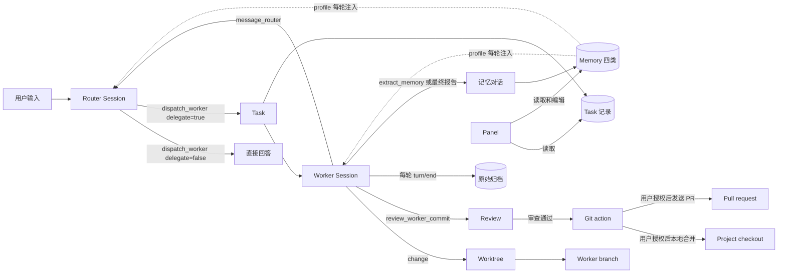

# 001 领域模型

这份文档命名 Superagent 轻量版的业务概念和每个概念守住的规则。代码、工具、面板和其余文档使用这些词。原始架构图按编号保存在 [001 术语与主流程](diagrams/001-terms-and-flow.md)、[002 预设流程](diagrams/002-preset-flow.md) 和 [003 记忆系统](diagrams/003-memory-system.md)。

## 流程

一条用户输入进入 Router Session。Router 先做一次派发决定：不需要项目工作就用 `dispatch_worker` 的 `delegate=false` 回答；需要项目工作就创建 Task 并启动一个 Worker Session。change worker 在分配的 Worktree 里修改文件、提交并请求独立 Review；report worker 在项目 checkout 里检查，用 `report_task` 交回结论。Worker 用 `message_router` 把最终结论送回 Router。审查通过的 HEAD 等待用户授权的 Git action：本地合并写回 Project checkout，或推送分支并打开 Pull request。Task 结束后，Worktree 和 worker 分支保留到下一次恢复或交付。记忆独立于 Task 存在：Worker 的每一轮历史按轮次归档，记忆对话从选定的结论里提取四类记录，profile 每轮注入 Router 和 Worker。

## 概念

| 概念 | 定义 | 守住的规则 |
| --- | --- | --- |
| 用户输入（Input） | 一条开启或继续回合的用户消息。 | 只有 `source.kind === 'user'` 的消息算输入；提醒使用 `superagent-lite-reminder` 来源，不算新输入；AGENTS.md 是仓库约定，不是任务；Worker 报告和环境事件是背景（`src/turn-guard.js:54-71`、`cordis.patch.yml:25-26`）。 |
| Router Session | 运行 `superagent-lite` 预设的 DSH Session。 | 每个输入先做一次派发决定；不编辑项目文件；只有用户明确授权后才合并（`router.js:1-14`、`cordis.patch.yml:21-43`）。 |
| 派发决定（Routing decision） | 当前回合内一次成功的 `dispatch_worker` 或 `continue_worker` 结果。 | 一个输入一个决定；失败的工具结果不算；最多 2 次提醒重开完成回合（`src/turn-guard.js:73-108`）。 |
| Task | 一次被委派的工作及其 JSON 记录。 | 只有 `dispatch_worker` 能创建；安装 owner 可从面板删除记录，删除不回收 worker 分支、Worktree 或记忆归档；ID 是 16 位小写十六进制；固定一个 Router Session、一个 Team、一个 Project 和一个 Worker Session（`src/dispatch.js:52`、`src/task-store.js:59-79`、`src/task-store.js:103-121`）。 |
| Team | Task 归属的团队名。 | 一个 Team 只拥有一个 Project，首次写入后不得改配（`src/task-store.js:70-75`）。 |
| Project | Task 工作的 Git 仓库。 | 派发时必须有分支被检出、工作区干净；Task 保存项目根、基础分支和基础 commit（`src/dispatch.js:62-67`）。 |
| Project checkout | Project 的主工作区，位于任何 Worktree 之外。 | report 任务在这里检查；本地合并只在这里写入（`src/report-tool.js:26-31`、`src/merge.js:28-55`）。 |
| Worker Session | 执行一个 Task 的 DSH Session，运行 `superagent-lite-worker` 预设。 | 从项目根启动；除 `create_worktree` 外的工具要求工作目录在分配的 Worktree；subagent 结束时冻结（`index.js:51-66`、`index.js:114-116`）。 |
| Worktree | worktree 服务为一个 Task 创建的隔离检出。 | 一个 Task 一个 Worktree，位于 `<project>/.agents/worktrees`，名字带 `sl-` 前缀；文件与其他 Task 分开；它不是操作系统安全边界（`cordis.patch.yml:1-7`、`src/worktree-tool.js:39-49`）。 |
| Worker branch | Worktree 所在的分支。 | 分支名取自 worktree 服务的返回值并写入 `task.worktree.branch`；只有审查过的 HEAD 会被合并或发布（`src/worktree-tool.js:40-49`、`src/git-actions.js:168-179`）。 |
| Review | 只读子代理对已提交 diff 的裁决。 | Reviewer 用 `submit_review` 记录裁决：内容「通过」即通过，其他内容记为审查意见；工具记录 reviewed HEAD 与 reviewer Session；裁决针对 Task 保存的需求，follow-up 只作上下文；审查本身不改 Task 状态（`src/review.js:12-34`、`src/review.js:84-122`）。 |
| Report | Worker 通过 `message_router` 发给 Router 的最终结论。 | 1–4,000 字符；只发一次，不发过程进度；文本不写 Task 状态，状态由生命周期事件写（`src/message-router.js:16-25`、`index.js:114-146`）。 |
| Follow-up | 对同一未发布 Task 的补充或修正。 | 只有目标 Deliverable 相同时用 `continue_worker`；记录在 `task.followUps`；发送失败时回滚记录（`src/continue.js:19-46`、`src/continue.js:62-105`）。 |
| 只报告任务（Report-only task） | `mode=report` 的 Task，只做诊断、分析、查找或只读检查。 | 不建 Worktree、不提交、不审查；结束时调用 `report_task`；项目 checkout 必须保持原样（`index.js:54-63`、`src/report-tool.js:19-41`）。 |
| Git action | 面板发起的 `merge`、`publish`、`review` 或 `delete-branch`；`merge` 也可来自用户直接指示或 `/merge-worker`。 | 合并只在用户明确授权后执行，始终是把 reviewed HEAD 合入所选本地分支的本地合并，不需要 `gh`；`publish` 需要用户点击、`gh` 账号和所选 GitHub remote，推送 reviewed HEAD 并创建或复用 Pull request；`review` 从 Worker Session 启动独立审查；`delete-branch` 移除已合并的 worker 分支及其 Worktree。四者都要求 full access 和未移动的 reviewed HEAD（`src/git-actions.js:398-493`、`src/merge.js:30-136`）。 |
| Pull request | GitHub 上承载已发布 Task 的检查与合并界面。 | PR 的 HEAD、head 分支、base 分支和跨仓库标记必须与 Task 完全一致；必需检查和分支保护在合并 PR 时由 GitHub 执行（`src/github.js:39-44`、`src/github.js:115-137`）。 |
| Memory | 保存下来的事实，分 private、public、profile、team 四类。 | private 只存凭据引用名；public 只存客观结论；profile 每轮注入；team 按 Team 与 Project 隔离；同一分类与 scope 内相同或等价的事实不新增，纠正覆盖原记录；记录是数据，不是指令（`src/memory.js:31-84`、`src/memory-store.js:174-183`、`src/memory-store.js:360-385`）。 |
| 记忆对话（Memory conversation） | 从选定结论中提炼记忆的独立 helper 子代理。 | 返回 private、public、profile、team 四个数组；每次最多 1/3/1/3 条，每条最多 500 字符；插件把结果写回各自分类并按分类与 scope 去重（`src/memory-extractor.js:4-41`、`src/memory.js:108-142`）。 |
| 原始归档（Raw archive） | Worker 对话的完整轮次记录。 | 每个 `turn/end` 存一轮，带 Session 序号和轮内 `reference` 编号；仅 Host 可写，模型工具读不到（`src/memory.js:213-226`、`src/memory-store.js:436-464`）。 |
| Task message | 跨 Session 的消息在聊天里的卡片。 | 应用 Host 补丁后，首个派发消息和空闲 Worker 的 follow-up 渲染为任务消息卡片；没有补丁时按普通用户消息显示（`docs/HOST-PATCH.md`、`docs/HOST-PATCH-AGENT-MESSAGE.md`）。 |
| Panel | Web 侧的「项目任务」面板。 | 只允许安装 owner 读取；任务列表是唯一状态分类来源，面板状态由任务、分支和审查事实推导；构建、发送 PR、审查、删除分支和删除任务记录都是任务行内的动作；记忆只在 owner 明确点击时写入（`src/board.js:7-45`、`src/status.js:6-34`、`client.js:573-781`）。 |

## 聚合

Task 是唯一聚合根。它持有：

| 字段 | 内容 |
| --- | --- |
| `id`、`title`、`teamId`、`task`、`mode` | 标识、显示标题、Team、保存的需求文本、`change` 或 `report` |
| `parentSessionId` | 发起派发的 Router Session |
| `projectRoot`、`baseCommit`、`baseBranch` | 项目根、worker 起点 commit、基础分支 |
| `workerSessionId` | 唯一的 Worker Session |
| `status` | 状态枚举中的一个值 |
| `worktree` | `path`、`branch`、`baseCommit`、`repositoryRoot`、`sourceBranch` |
| `review` | `head`、`reviewerSessionId`、`approved` |
| `mergeTarget`、`branchDeletedAt` | 本地合并的目标分支，以及 worker 分支被删除的时间 |
| `followUps` | 追加要求条目，含 `id`、`text`、`at` |
| `report` | 只报告任务的结论与时间 |
| `prUrl`、`prState` | 已发布 Pull request 的地址与状态 |
| `failure` | 最近一次派发或交付错误 |
| `stopReason`、`finishedAt`、`createdAt`、`updatedAt` | 结束原因与时间 |

Router Session、Worker Session、Reviewer 和记忆对话都是 DSH Session，不是 Task 字段；Task 只保存它们的 ID。GitHub、`gh` 和 worktree 服务是外部系统，通过 Host 服务与 Git 命令接入，不进入领域模型。

## 术语

| 术语 | 中文 | 含义 |
| --- | --- | --- |
| Input | 输入 | 开启或继续回合的用户消息 |
| Router | 路由器 | 决定谁来工作的 Session |
| Router Session | 路由会话 | 运行 `superagent-lite` 预设的 Session |
| Routing decision | 派发决定 | 当前回合内一次成功的派发工具结果 |
| Worker | 执行者 | 执行一个 Task 的 Session |
| Worker Session | 执行会话 | 运行 `superagent-lite-worker` 预设的 Session |
| Task | 任务 | 一次委派的工作及其记录 |
| Team | 团队 | Task 归属的团队名 |
| Project | 项目 | Task 工作的 Git 仓库 |
| Project checkout | 项目工作区 | 主工作区，位于 Worktree 之外 |
| Worktree | 工作树 | 一个 Task 的隔离检出 |
| Worker branch | worker 分支 | Worktree 所在的分支 |
| Review | 审查 | 对已提交 diff 的只读裁决 |
| Report | 报告 | Worker 发给 Router 的最终结论 |
| Follow-up | 追加要求 | 对同一未发布 Task 的补充或修正 |
| Report-only task | 只报告任务 | 不修改项目的 Task |
| Git action | Git 操作 | 合并、发送 PR、审查或删除分支 |
| Pull request | 拉取请求 | GitHub 上的发布与合并界面 |
| Memory | 记忆 | 四类保存下来的事实 |
| Memory conversation | 记忆对话 | 提炼记忆的 helper 角色 |
| Raw archive | 原始归档 | 完整、带编号的 Worker 轮次记录 |
| Task message | 任务消息 | 跨 Session 消息的聊天卡片 |
| Panel | 面板 | Web 侧「项目任务」界面 |

## 枚举值

Task 记录只保存一个生命周期状态。下表的生命周期值都有写入路径；`unconfirmed` 不是状态，而是面板给失联的运行中 Task 加的标签。六个面板状态是另一套在读取时推导的枚举（`src/status.js:6-34`）。

| 组 | 取值 | 含义 |
| --- | --- | --- |
| 派发 | `starting` | 记录已创建，Worker 正在启动（`src/dispatch.js:80-83`） |
| 工作 | `running` | Worker 已创建或 Worktree 已保存，任务进行中（`index.js:51-52`、`src/worktree-tool.js:49`） |
| 工作 | `resuming` | 已结束的 Task 被 follow-up 重新打开（`src/continue.js:82-90`） |
| 审查 | `review-required` | Worker 结束时没有通过的审查，或审查后 HEAD 又移动（`index.js:131-140`） |
| 交付 | `awaiting-merge` | 审查过的 HEAD 等待用户授权的交付动作（`index.js:141`、`src/git-actions.js:291-302`） |
| 交付 | `merging` | 本地合并已开始（`src/merge.js:67-71`） |
| 交付 | `publishing` | 发送 PR 的路径已开始（`src/git-actions.js:440-444`、`src/git-actions.js:476-478`） |
| 交付 | `awaiting-ci` | reviewed HEAD 的 PR 已打开；面板读取时用 `gh` 同步 PR 状态（`src/github.js:92-109`、`src/git-actions.js:278-283`） |
| 交付 | `merged` | 提交已进入基础分支：本地合并、外部合并 PR，或面板读取时确认已包含在基础分支（`src/merge.js:78-80`、`src/git-actions.js:309-317`） |
| 交付 | `delivery-blocked` | 发送或合并失败，或精确匹配的 PR 被关闭（`index.js:142-144`、`src/git-actions.js:273-277`、`src/merge.js:50-52`） |
| 结束 | `completed` | 只报告任务通过 `report_task` 交付了结论（`src/report-tool.js:34-39`） |
| 结束 | `failed` | 派发、Worker 回合或 follow-up 发送失败（`src/dispatch.js:101-107`、`index.js:123-129`、`src/continue.js:97-102`） |

面板字典还识别 `ready`、`merge-queued`、`merge-conflict`、`interrupted`、`cancelled` 这些文案，但当前代码没有写入这些状态（`client.js:8-15`、`src/status.js:8-10`）。

## 面板状态

面板从存储状态、worker 分支、审查记录和 Pull request 事实推导出一套独立的六值状态，不写回 Task 记录；推导顺序由 [003 生命周期](003-lifecycle.md) 定义。

| 面板状态 | 含义 |
| --- | --- |
| `unmerged` / 未合并 | 当前 worker HEAD 已审查通过且尚未合并；用户可以合并或发送 PR |
| `running` / 运行中 | Worker 或交付动作正在进行 |
| `unreviewed` / 未审查 | worker 分支有提交，但当前 HEAD 没有通过的审查 |
| `completed` / 已完成 | reviewed HEAD 已合并，或 Worker 结束时没有可交付的提交 |
| `failed` / 失败 | Worker 回合、交付动作或 Task 失败 |
| `answer` / 仅回答 | report 任务交回了报告 |

Task 模式有两个值。

| 模式 | 取值 | 含义 |
| --- | --- | --- |
| 模式 | `change` | 默认值；Worker 修改项目文件、提交并请求审查 |
| 模式 | `report` | Worker 在项目 checkout 检查，不提交，以 `report_task` 结束 |

## 图表对齐

[diagrams](diagrams/) 里的原图是术语和流程的参照。实现与图不一致的地方列在下表；代码和其余文档按实现写。

| 原图规则 | 实现 |
| --- | --- |
| Router 每轮处理一个「调用 worker」工具，可以不调用，但要写明为什么 | 派发守卫要求每个用户输入有一次成功的 `dispatch_worker` 或 `continue_worker`；`delegate=false` 加 1–2,000 字符理由就是不派 worker 的决定，没有决定的完成回合会被提醒（`src/turn-guard.js:73-127`）。 |
| 同一业务的补充在业务面板添新业务，再派 worker | 实现用 `continue_worker` 继续同一个未发布 Task，不新增第二行；不同业务目标或已发布的 Task 新建 Task 和 Worker（`src/continue.js:51`）。 |
| Worker 处理完毕，结果返回 Router，能力冻结，业务算已完成 | change worker 结束后进入审查和交付，落为 `review-required`、`awaiting-merge`、`failed` 或 `delivery-blocked`；只有 report 任务在 `report_task` 后到 `completed`（`index.js:123-145`、`src/report-tool.js:34-39`）。 |
| 提问由 Router 回答，可查询记忆 | 相同；Router 只在用户要求或路由需要某条已保存事实时调用 `superagent_memory`，然后直接回答（`src/memory.js:31-84`）。 |
| 若干 worker 组成团队，一个项目通常由一个团队管理，不同项目由 Router 分开 | 相同；第一个 Task 固定 Team 与 Project 的一对一关系，之后不能改配（`src/task-store.js:70-75`）。 |
| 团队知识库按团队隔离，只有同团队 worker 能读 | 存储还绑定规范化后的 Project 根；同 Team 但不同 Project 的 Worker 读不到（`src/memory-store.js:174-183`）。 |
| 私有信息保存密钥等 | 存储只接受凭据引用名，拒绝形似密钥的内容；记录本身不保存密钥值（`src/memory-store.js:12-14`、`src/memory-store.js:38-57`）。 |
| 对话历史全量保留并编号；记忆提取有用信息 | 每个 Worker 回合完整归档，事件带 Session 序号和从 1 开始的轮内 `reference`；提取只接收选定结论或最终报告，不接收原始 transcript（`src/memory.js:213-226`、`src/memory.js:108-142`）。 |
