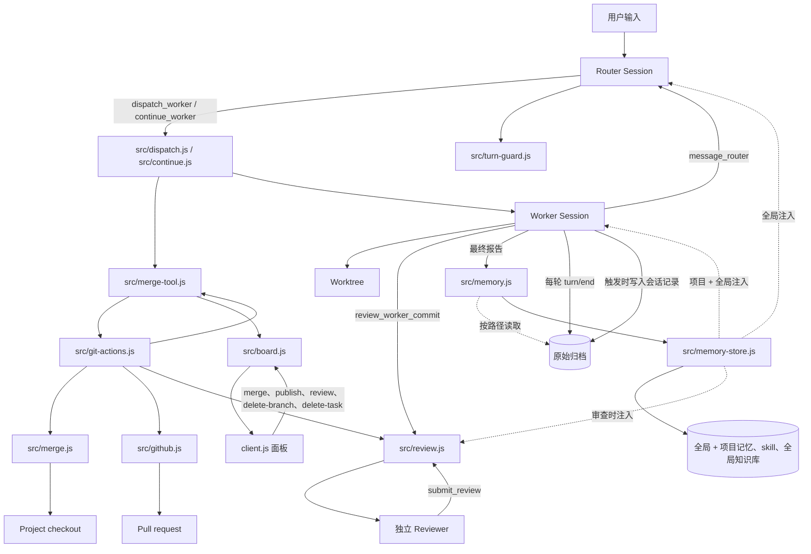

# 007 架构

这份文档把 [001 领域模型](001-domain.md) 的概念映射到文件、服务和数据。先读「核心流程」和「依赖规则」，再把「模块」与「测试」两张表当索引用。它建立在 [000 原则](000-philosophy.md) 到 [006 部署](006-deployment.md) 之上。

## 核心流程

Host 插件 `index.js` 管理 Worker 生命周期、记忆注入和面板路由；Router 插件 `router.js` 注册路由工具、状态查询工具和全局记忆上下文。merge 任务的目标分支合入由 `src/merge-tool.js` 执行，最终合入 base branch 仍走 Worker 的 shell 落地围栏。两个入口都通过 `ctx` 使用 DSH 服务，源文件不 import DSH 包（`index.js:1-318`、`router.js:1-9`）。

## 核心模块

### `index.js`

Host 生命周期入口。`agent/created` 为 Worker Session 找到 Task，把 `starting` 或 `resuming` 改为 `running`，安装工具守卫，按条件注册 `create_worktree`、`review_worker_commit`、消息和报告工具，并注册 `knowledge_query` 与 `knowledge_get`（`index.js`）。如果 Task 已被面板停止成 `cancelled`，它不会写回 `running`，而是直接中断新 agent。report worker 的守卫放行项目 checkout 内的只读检查工具和 checkout 之外的只读检索工具（网页搜索、网页读取、知识库和后台任务查询），继续拒绝写改文件、创建 Worktree、提交和改变 HEAD；其余 Worker 仍须先进入分配的 Worktree。它为已认领的 Reviewer 注册 `submit_review`、`knowledge_query` 和 `knowledge_get`，为 memory 角色注册这两个读取工具与 `knowledge_write`；并注册 `/superagent-lite/tasks`、`/superagent-lite/git`、`/superagent-lite/worker-settings`、`/superagent-lite/memory` 和 `/superagent-lite/branches` 五个路由；新 Host 的 `connection.admit` 从调用方 fiber 读取 `connection.authentication`，所以这些路由只在注入了该服务的上下文注册，旧 Host 则靠自带的 `requestRejection` 判断走无需该服务的注册路径（`index.js:40-81`）。任务停止由 `stopWorker` 完成；删除任务时先停止并等待 worker 离开运行态。它把项目 + 全局记忆注册为 Worker 的必需运行时上下文，并在 Worker 创建时读取。插件启动时扫描一次旧记录，之后启动队列在派发、Task 结束、停止任务、Worker 释放名额和保存并发设置时调用 `pumpWorkers`；启动扫描和每次 pump 都会回收失联超过 2 分钟且没有活着 Worker Session 的 `starting`、`running`、`resuming` Task：读 Review 记录、worker 分支与 Worktree HEAD，Review 通过且 HEAD 匹配时落为 `awaiting-merge`，否则落为 `failed` 并释放名额（`index.js:314-317`、`src/launch-queue.js:52-119`、`src/launch-queue.js:190-195`）。

`subagent/end` 落定 change 和 merge 任务：`review-required`、`awaiting-merge`、`failed` 或 `delivery-blocked`；report 任务未交报告则 `failed`。`session/event` 把事件交给派发守卫，并在 Worker 的 `turn/end` 触发原始归档。它不决定路由，也不编辑项目文件。

### `router.js`

装载时先刷新并注册全局记忆上下文，再注册 `dispatch_worker`、`continue_worker` 和 `worker_status`。Router 只读取全局记忆；Router 预设的 skill 根也只保留全局 skill 根。`worker_status` 只查询本 Router Session 派发的任务，不派发工作（`src/worker-status.js`）。`dispatch_worker` 的 `mode=merge` 把目标分支解析后写入 Task 的 `mergeBranches`：同一 Router Session 和 Project 没有运行中的 merge worker 时启动一个新的；有则把目标追加到该 Task 并给 worker 发送 follow-up（`src/dispatch.js:107-283`）。它不持有 Task 记录。

### `src/memory.js`

定义记忆字段、注入文本、memory 角色提示词、多个命名 skill 的提取流程、面板读取/删除视图、全局知识库查询/读取/写入工具和轮次归档。Worker 和 Reviewer 读取项目 + 全局记忆；Router 只读取全局记忆。memory 触发时先把 Worker 的完整会话写成 `task/archive/sessions/<sha256(Session ID)>.md`，触发消息只带记录路径、任务/角色/分支等元信息、项目 skill 已用数量与 10 个上限，以及每条 skill 的名称和作者（`author: memory` 或 `none`），memory 自己按路径读取；最终报告工具的参数不进入记录。skill 的 description 只通过会话里的 skill catalog 获知；触发消息不含 skill 路径、description、正文或 skill 根目录，需要正文时按名调用 `skill` 工具。提示词要求项目 skill 最多 10 个、达到上限只复用已有名字更新，并写明知识、事实、经验、结论进全局知识库而 skill 只放可复用固定流程。提取结果先按项目、再按全局批量写 skill，项目 skill 超限会在写任何字段前失败，不产生半写入。知识库通过 `knowledge_query` / `knowledge_get` 读取、通过 `knowledge_write` 写入，只有 memory 角色能写；面板的删除视图从这里清空记忆字段、删除 memory 管理的 skill 和知识条目（`src/memory.js`）。

### `src/memory-store.js`

保存全局记忆、项目记忆、全局知识库、全局/项目 skill 文件、原始归档和 memory 读取的会话记录；项目 skill 目录同时写入 `.git/info/exclude`，避免弄脏项目 checkout。Worker 和 Reviewer 创建时会在各自 scope 注册一个 project-skill provider，从项目 checkout 读取所有由 memory 管理的项目 skill，供 catalog 使用。`writeSkill` 以 `name` 决定目录，在 frontmatter 写入 `author: memory`；既有固定名字没有 author 时仍可读取和更新，写入时补上 author。同名文件已有其他作者时拒绝写入，不静默覆盖。`writeSkills` 在一次 skill 根锁内先校验整批名字、作者冲突和 `MAX_PROJECT_SKILLS = 10` 的项目 skill 上限，再写文件，因此超限批次不会留下部分 skill；达到上限后只允许更新已有项目 skill 名字，新建被明确拒绝。`projectSkillCount` 统计项目下所有可解析的 skill 目录（包括非 memory 管理的目录），供提示词报告当前用量；`readSkillAuthors` 列出全部全局/项目 skill 的名称和作者（`memory` 或 `none`），供提示词逐条标注归属。`deleteSkill` 按名字删除该 skill 的目录和 `SKILL.md`；`deleteMemoryField` 清空记忆字段；`memoryAuthoredSkillNames` 直接扫描 skill 文件并只收集 `author: memory` 的名字，供 catalog 归属判断使用。全局记忆和知识库各是一个 JSON 文档；项目记忆按规范化项目根哈希分文件；字段校验上限 4,000 字符，skill description 最多 500 字符，知识条目最多 200 条；写入使用临时文件 + rename，目录 `0700`、文件 `0600`；skill 写成 DSH 兼容的 `SKILL.md`；归档位于 `task/archive/`（`src/memory-store.js`）。

### `src/task-store.js`

Task JSON 的唯一存储模块。默认根目录 `~/.dsh/superagent-lite`，创建 `tasks/`、`tasks/sessions/` 和 `tasks/cancelled/`；记录以 `0600` 原子写入，按根和键串行化；创建时强制 Team 与 Project 一对一；提供 Session ID 到 Task 的反查。`stopTask` 在同一 Task 锁内把 `queued`、`starting`、`running` 或 `resuming` 写成 `cancelled` 终态并保留活动记录；重复停止返回 `stopped: false`，其他终态抛错，避免停止与启动队列竞争。`removeTask` 删除记录和会话映射；`listCancelledTasks` 读取旧版本留下的取消墓碑（`src/task-store.js`）。

### `src/dispatch.js`

校验参数；`mode=answer` 直接返回未委派，不建 Worktree、不建 Task、不写 Task 记录。其余模式从 Router agent 与 call ID 派生 Task ID，读取项目根和工作区状态：Git 项目要求基础 commit、基础分支和干净工作区；非 Git 目录把当前目录作为项目根并写入 `git: false`，不要求 commit、分支或干净工作区。随后写 `queued` 记录，建立 Session 映射，交给启动队列在名额内启动。启动失败把 Task 标为 `failed`。非 Git 项目拒绝 `mode=merge` 和 `land=true`。`mode=merge` 先按 Router 和 Project 串行，找到有活 Worker Session 的运行中 merge Task 时把目标追加到 `mergeBranches`、把请求记入 `followUps` 并发送 follow-up；没有才创建新 Task。派发时 `images` 指定的本地图片先保存为附件引用并写进 Task，worker 启动时附在首条消息后（`src/dispatch.js:147-283`、`src/launch-queue.js:148-161`）。

### `src/worker-status.js`

Router 的状态查询与通知模块。`createWorkerStatusTool` 提供 `worker_status`：按 `queued`、`running`、`delivered`、`cancelled`、`failed` 分组返回本 Router Session 的 Task，包含 Task ID、标题、Team、模式、Worker Session 和存储状态，可传 `taskId` 只查一个。`stopWorker` 停止 Task 后调用 `notifyWorkerStatus`；启动队列在 Worker 启动成功后也调用同一通知函数。通知以 `source.kind = superagent-lite-worker-status` 注入 Router 的下一模型步，不打开新回合，也不算新用户输入（`src/worker-status.js`）。

### `src/continue.js`

把 follow-up 送给运行中的 Worker 或空闲 Worker。运行中发短更新；空闲或已结束时发精简续派发消息（任务标识、不可变规则、唯一权威的 Follow-up），report 任务用只读和 `report_task` 规则，仅在检测到上下文压缩时回放原需求。已结束的 Task 先改 `resuming`，保留旧 Review 记录；同样的入口也用于 `resuming` 的再次追加和 BLOCKED 后没有 Worktree 的恢复；`queued`/`starting` 返回稍后再试而不投递。已经合并、worker 分支被删除或记录的 Worktree 已不存在的 Task 拒绝恢复。follow-up 先记录，发送失败回滚；`images` 指定的本地图片附在跟进消息文本之后（`src/continue.js:46-68`、`src/continue.js:195-212`、`src/continue.js:260-291`）。

压缩检测读取 Worker Session 的推导消息，找 `compact-checkpoint` 来源；活着的 Worker 直接读 Session，未加载的 Worker 通过 `ctx.sessionQuery.inspectSession` 读取持久化会话，不重新挂载。两个入口都不可用时保守地不回放原需求。

### `src/worker-prompt.js`

生成 change 和 report 两种任务消息。它统一 `Project team`、`Base branch`、`Task`、`Requirements`、模式段和 `Before` / `During` / `After` / `Reporting` 段；非 Git 项目把头部写成无基础分支，并把 change 段换成直接在工作区修改、不建 Worktree/不提交、调用工作区审查；report 段也要求按仓库 `AGENTS.md` 的约定执行，但不扩大只读任务的授权；报告、结论和审查请求如何附带 `images` 也写在这些段落里（`src/worker-prompt.js:1-152`）。

### `src/turn-guard.js`

按 Session 和回合统计用户输入与成功的路由决定（派发、续派或状态查询）。完成回合没有决定时，在 idle 后插入提醒；每个输入最多 2 次；只对 `superagent-lite` 预设生效（`src/turn-guard.js:1-133`）。

### `src/worktree-tool.js`

通过 `ctx.worktrees.create` 从 base commit 创建 Worktree，名字为 `sl-<worktreeName>-<Task ID 前 12 位>`，保存 `path`、`branch`、`baseCommit`、`repositoryRoot`、`sourceBranch`，并把 Worker 工作目录切过去。第二次调用只重新进入；非 Git 任务调用时直接拒绝（`src/worktree-tool.js:23-64`）。

### `src/landing.js`

保存每个 Task 的落地状态：dispatch 写入 `land` 和 `mode`，create_worktree 写入分支，review 与面板写入 reviewed HEAD，continue 可追加推送/PR 授权。`index.js` 的 shell guard 用它检查 `git push`、`git merge`、`gh pr create` 和 `gh pr merge`；未授权、未审查或越界时返回拒绝原因。`git merge` 只对 `mode=merge` 的 Task 开放，change/report 任务即使有 `land` 也不能合并（`src/landing.js:1-416`、`src/worker-prompt.js:64-106`）。

### `src/review.js`

提供 `worktreeHead`：检查仓库根、分支、干净工作区和 HEAD（`src/review.js:46-56`）。`runReview` 在 Git 项目检查净改动，读取项目 + 全局记忆，创建改动范围，启动独立 Reviewer（只禁写改工具与改变分支或历史的 git 命令），从 Reviewer 的 `submit_review` 取回裁决（内容「通过」是通过，其他内容记为意见），校验证据并复核 HEAD 后写入 Review；非 Git 项目以项目根为审查对象，没有 commit/diff，证据是读过项目文件，Review 记录工作区标识 `workspace`（`src/review.js:17-39`、`src/review.js:91-167`）。`review_worker_commit` 和面板的审查动作共用 `runReview`；Reviewer 的提示词不包含 diff，但可以把 worker 指定的本地图片块附在提示词之后（`src/review.js:59-141`）。

### `src/review-scope.js`

定义 Reviewer 的「改动」：Git 项目是 Worktree 加 `base..head`，非 Git 项目是整个项目根的工作区。Reviewer 可以读取任意文件和运行任意命令；它只拒绝会改变 git 分支或历史的子命令，并记录 Reviewer 是否真的读过 diff、改动文件或项目文件（`src/review-scope.js:1-294`）。

### `src/helper-guard.js`

维护待认领 helper 队列并安装 guard。记忆对话没有审查范围，保持只读：放行只读工具集（`structured_output`、`read`、`read_image`、`glob`、`grep`、`skill`、`read_page`、`web_fetch`、`web_search`、`x_search`、`job_output`、`job_list`、`knowledge_query`、`knowledge_get`）和受限 shell，并强制 Session 的 `read-only` 沙箱；`skill` 只读取 catalog 中按名加载的 skill 正文，不写文件。`knowledge_write` 只对 memory 角色放行。Reviewer 带审查范围时改用审查 guard：除写改工具外全部放行，shell 命令只交给 `review-scope` 检查 git 分支变更（`src/helper-guard.js:4-20`、`src/helper-guard.js:75-119`）。

### `src/delivery.js`

合并与发送 PR 共用的交付前置校验。`deliverableHead` 要求 Task 已结束 Worker 工作（`awaiting-merge` 或 `awaiting-ci`）、有 worker 分支和 Worktree、`review.approved === true` 且当前 HEAD 等于 `review.head`；`assertStillDeliverable` 在准备阶段复核状态与 Review，防止续派发或新提交从准备窗口混入。发送 PR 额外的 GitHub 账号与 remote 校验留在 `src/git-actions.js`（`src/delivery.js:1-19`）。

### `src/merge-tool.js`

merge worker 的 `merge_branch` 工具。它只接受 Task 的 `mergeBranches` 中的分支，把目标分支用 `git merge --no-ff --log` 合入该 Worker 自己的 worktree 分支，目标分支的 commit 摘要随合并提交进入历史；冲突时保留 merge 现场并列出冲突文件，由 Worker 解决、提交后继续。它不写共享 checkout，也不改 Task 状态（`src/merge-tool.js:1-68`）。

### `src/message-images.js`

把工具参数里的本地图片路径变成 Host 消息图片块。它从文件签名识别 PNG/JPEG/WebP/GIF，按会话工作目录解析路径，按 Host 的 `imageLimits` 检查单条消息的图片数量和总字节数，再调用 `ctx.attachments.saveImage` 保存并返回 `{ type: 'image', attachment }`（`src/message-images.js:23-96`）。`imagesParameter` 是 `dispatch_worker`、`continue_worker`、`message_router`、`report_task` 和 `review_worker_commit` 共享的参数 schema；`imageBlocksFromReferences` 供启动队列把 Task 记录的附件引用还原成首条消息的图片块（`src/launch-queue.js:148-161`）。工具参数只能传本地路径，不接受 URL、base64 或 GUI 上传的附件。

### `src/merge.js`

实现本地合并和分支删除。`mergeWorkerBranch` 先用共用的 `deliverableHead` 校验交付前提，再检查目标分支、干净 checkout 和 `merge-tree` 预检，切到所选目标，执行 `git merge --no-ff --log -m "Merge branch '<worker branch>'" -m '<task title>'`，让 base branch 历史保留分支的功能性 commit 及其摘要，复核目标后切回，记录 `merging`、`merged` 或 `delivery-blocked`（`src/merge.js:31-110`）。同一 Project 根的合并和删除在此排队，共享 checkout 不会被两个合并同时切换；`deleteWorkerBranch` 对仍有 worker 分支的 Task 先移除登记且干净的工作树，再删除分支，运行中、工作树脏、被其他工作树检出或移除后仍存在时拒绝（`src/merge.js:14-27`、`src/merge.js:112-170`）。用户直接指示的合并由 router 派发 `mode=merge` 的 worker，不续派原任务。

### `src/git-actions.js`

推导每个 Task 的六个面板状态，采纳同一 commit 由另一个 Task 记录的通过审查，读取本地分支、remote 和 `gh` 账号，并执行面板的 `merge`、`publish`、`review` 和 `delete-branch`。非 Git 任务没有分支，读取时不调用 git/gh，也没有这些交付动作；`delete-branch` 不要求分支已合并，运行中的 Task 禁用；删除后返回与重新读取一致的行视图，供面板就地更新。它缓存 PR 事实 30 秒，把精确 PR 状态同步进 Task，用共用的 `deliverableHead` 检查状态、审查和 HEAD，再检查目标或 remote，按 Task 串行化动作；发送 PR 额外检查 `gh` 账号；状态推导和审查索引在 `src/status.js`（`src/git-actions.js:68-702`）。

### `src/github.js`

把 remote URL 解析为 GitHub 仓库，把 reviewed commit 推送到所选 remote，打开或复用针对 base branch 的 PR，并复核精确 HEAD 和 base。它是唯一的 GitHub 写路径（`src/github.js:1-100`）。

### `src/process.js`

通过 `ctx.subprocess` 运行 `git` 和 `gh`，过滤 `GIT_*` 和 `GH_DEBUG` 环境，禁用提示和 hooks，限制输出 65,536 字节（`src/process.js:7-36`）。同步 `runCommandSync` 只供 worker shell guard 在命令执行前读取分支和 HEAD（`src/process.js:38-48`、`src/landing.js:71-80`）。

### `src/board.js`

提供 `GET /superagent-lite/tasks`、`POST /superagent-lite/tasks`（`action=stop`）、`DELETE /superagent-lite/tasks?taskId=`、`GET /superagent-lite/git?taskId=` 和 `POST /superagent-lite/git`。只允许 owner，投影公开 Task 字段，叠加推导出的面板状态，标记 `unconfirmed`、`stoppable`、`cancelled` 和 `deletable`；`POST` 停止运行中或排队中的 Task 并返回 `cancelled` 状态，`DELETE` 先停止并等待 worker 离开运行态再删除记录与 worker 会话映射；合并或发布中的 Task 拒绝删除。限制 JSON body 4 KB，校验合并目标或 PR remote，并把动作拒绝映射为 `409`；还提供 JSON body 读取工具（`src/board.js:1-232`）。

### `src/report-tool.js`

结束 report 任务：检查活跃 Worker、report 模式、没有 Worktree，Git 项目还要求 HEAD 仍在 base commit、checkout 未变；非 Git 项目跳过 git 校验，把结论和证据发给 Router，并写入 `completed`（`src/report-tool.js:1-49`）。

### `src/message-router.js`

把 Worker 的最终结论发给 Router，要求活跃 Worker 和 1–4,000 字符文本；送达后触发 change 任务的 memory 提取（`src/message-router.js`）。

### `client.js`

浏览器面板。注册 `main` 和 `sidebar.panellist` 槽位与 `superagent-lite` 字典；加载任务，按六个面板状态分组和过滤，也可单独筛出「排队中」的 Task，按 Team/Project 缩小任务，渲染会话和 PR 链接，提交 stop、merge、publish、review、delete-branch 和 delete-task 动作，并支持勾选多条任务后批量删除。停止对运行中或排队中的行出现，成功后按 Host 返回的 `cancelled` 状态就地更新该行并显示「已取消」标签，不弹窗、不重新加载列表；删除任务先停止再移除记录，弹窗写明运行中的 worker 会被先停止。合并弹窗选择本地目标分支；提交 PR 弹窗检查 `gh` 账号并选择 remote；审查从 Worker Session 启动；凡是还有 worker 分支的行都有删除分支按钮，运行中禁用，确认后按 Host 返回的视图就地更新该行并隐藏按钮。记忆系统标签页展示全局/项目记忆、全局/项目 skill 和全局知识库，顶部搜索框按关键词本地过滤已加载的记忆字段、skill 名字/description/正文和知识条目，不发新请求；分组使用带标题、说明和计数的卡片，长字段和知识条目默认截断，skill 默认折叠摘要、点击展开正文；并支持确认后删除记忆字段、memory 管理的 skill 或知识条目；分支 / worktree 标签页在选中时读取本插件创建的 Worktree 和 `sl-*` 分支，展示分支、路径、任务和状态，提供分开的删除 Worktree / 删除分支确认弹窗，成功后就地更新该行；任务列表里还有排队中的 Task 时，面板每 3 秒静默轮询任务列表并就地更新，名额释放后该行转为运行中；其他时候不轮询。面板不显示设置分组（`client.js:1-1587`）。它不 import Node 模块，状态只在 React 内。

## 依赖规则

- `index.js` 和 `router.js` 是唯一插件入口。`src/` 不 import 这两个入口或 `client.js`。
- `client.js` 只在浏览器运行，通过模块加载器使用 `react`、`slots` 和 `locale`。
- 没有源文件 import `@deepseek-ai/*` 包。Host 能力通过 `ctx` 服务提供：`subagents`、`tools`、`worktrees`、`subprocess`、`agents`、`agentPresets`、`sandboxPolicy`、`workingDirectory`、`systemPrompt`、`webServer`、`connection`、`connection.authentication`。
- `src/process.js` 是唯一进程启动器；所有 `git` 和 `gh` 调用经它执行（`src/process.js:7-35`）。
- `src/task-store.js` 是唯一 Task 记录存储模块；其他模块调用 `createTask`、`updateTask`、`readTask`、`removeTask`、`stopTask`、`listCancelledTasks`、`listTasks`、`linkWorkerSession` 或 `taskForSession`（`src/task-store.js`）。
- `src/worker-stop.js` 负责停止流程（写 `cancelled`、中断 worker、释放名额、可选等待空闲）；`src/worker-control.js` 封装 `ctx.subagents.interrupt` 和等待 worker 停止，启动队列与 `agent/created` 共用同一中断路径。
- `src/worker-status.js` 是唯一 Task 状态查询和 Router 状态通知模块；`worker_status` 只读，通知使用独立的 `superagent-lite-worker-status` 来源。
- `src/helper-guard.js` 是唯一 helper 计数器和只读 guard 安装者（`src/helper-guard.js`）。
- `src/memory-store.js` 是唯一记忆、知识、skill 文件和归档存储模块；`src/memory.js` 是唯一记忆提示词、提取流程和知识工具模块。
- `src/github.js` 和 `src/merge.js` 是面板的交付写路径；`src/merge-tool.js` 是 merge worker 的目标分支合入路径；授权 Worker 的 shell 落地由 `index.js` 的 guard 经 `src/landing.js` 检查（`src/github.js:64-100`、`src/merge.js:30-142`、`src/merge-tool.js:13-64`、`src/landing.js:387-416`）。
- `src/status.js` 是唯一把存储状态、Git 事实和审查记录变成面板状态的地方（`src/status.js:6-52`）。

### 状态写者

| 转换 | 写者 |
| --- | --- |
| → `starting` | `src/dispatch.js` |
| → `running`，agent 创建后 | `index.js` |
| → `running`，Worktree 保存后 | `src/worktree-tool.js` |
| → `resuming` | `src/continue.js` |
| → `review-required` | `index.js` |
| → `awaiting-merge` | `index.js`；`src/git-actions.js` 在读取时修正 |
| → `merging` | `src/merge.js` |
| → `merged`，本地合并 | `src/merge.js` |
| → `merged`，精确 PR 已合并 | `src/git-actions.js` |
| → `merged`，worker HEAD 已包含在基础分支 | `src/git-actions.js`，读取时；HEAD 不是基础 commit，且存储状态属于交付状态 |
| → `publishing` | `src/git-actions.js` |
| → `awaiting-ci` | `src/github.js`；`src/git-actions.js` 在读取时修正 |
| → `delivery-blocked`，审查后 HEAD 检查失败 | `index.js` |
| → `delivery-blocked`，发送失败 | `src/git-actions.js` |
| → `delivery-blocked`，本地合并失败 | `src/merge.js` |
| → `delivery-blocked`，精确 PR 关闭 | `src/git-actions.js` |
| `review` 记录，面板审查后 | `src/git-actions.js` 经 `src/review.js` |
| `worktree` 清空、记录 `branchDeletedAt`，删除分支后 | `src/merge.js`、`src/git-actions.js` |
| → `completed` | `src/report-tool.js`；非 Git change 任务审查通过后由 `index.js` |
| → `failed`，派发失败 | `src/dispatch.js` |
| → `failed`，Worker 回合失败 | `index.js` |
| → `failed`，follow-up 发送失败 | `src/continue.js` |
| → `cancelled`，面板停止 | `src/task-store.js` 经 `stopTask`，`src/worker-stop.js` 随后中断 worker 并释放名额 |
| `unconfirmed` | `src/board.js`，只在读取时计算 |

## 模块

| 路径 | 职责 |
| --- | --- |
| `src/board.js` | 提供 owner-only 任务列表、停止、任务删除与 Git 动作 HTTP 端点，并投影面板视图。 |
| `src/status.js` | 推导六个面板状态（非 Git 任务审查通过即完成），并按 Project 与 commit 索引通过的审查。 |
| `src/continue.js` | 把 follow-up 送给运行中或空闲 Worker，处理恢复记录和发送失败回滚。 |
| `src/delivery.js` | 合并与发送 PR 共用的状态、审查和 HEAD 前置校验。 |
| `src/dispatch.js` | 校验派发并识别 Git/非 Git 项目；`mode=answer` 直接返回，`change`/`report` 创建 Task 记录并启动 Worker Session；非 Git 项目拒绝 `merge`/`land`；`mode=merge` 把新请求追加给运行中的 merge worker，没有才新派发。 |
| `src/git-actions.js` | 构建面板视图（非 Git 任务不调用 git/gh），执行合并、发送 PR、审查和删除分支动作；为「分支 / worktree」标签页推导本插件创建的 Worktree 与 `sl-*` 分支，并执行只删 Worktree 或只删分支的动作。 |
| `src/github.js` | 把 reviewed commit 交付到所选 GitHub remote 的 Pull request。 |
| `src/helper-guard.js` | 计数待认领 helper；记忆对话保持只读，Reviewer 只禁写改工具与改变分支的 git 命令。 |
| `src/host-patch.js` | 插件启动时从运行入口解析已安装的 `@deepseek-ai/dsh`，对 `0.2.2-rc.1` 到 `0.2.3-alpha.1` 的 npm Host 自动补打客户端任务卡补丁与子代理 `promptSource` 补丁；rc.1 使用仅 bundle 的子代理 diff，`0.2.3-alpha.1` 只补客户端并报告 `native`；已打过时不动，版本/布局不匹配、片段失败或只读安装只写告警，不阻断启动；DSH-go 不自动修改。 |
| `src/landing.js` | 持有 Task 的落地授权与 reviewed HEAD，检查 Worker shell 的 push、PR 与 merge 范围。 |
| `src/launch-queue.js` | 按并发上限启动或排队 Worker；新启动的 Worker 使用保存的模型，启动前重读 Task 避免停止后仍启动，并向 Router 通知排队任务已开始；启动扫描和每次 pump 回收失联超过 2 分钟且没有活 Session 的 `starting`/`running`/`resuming` Task，按 Review、分支和 Worktree HEAD 落为 `awaiting-merge` 或 `failed`。 |
| `src/message-images.js` | 把工具参数里的本地图片保存为 Host 附件引用，并生成消息图片块；校验格式、数量和字节上限。 |
| `src/merge.js` | 实现本地 `--no-ff --log` 合并（保留分支提交摘要）、分支删除，以及标签页使用的只删干净 Worktree、只删无 Worktree 检出分支两个动作。 |
| `src/merge-tool.js` | merge worker 的 `merge_branch` 工具：把记录的目标分支合入自己的 worktree 分支，冲突留给 Worker 解决。 |
| `src/memory.js` | 定义记忆字段、注入文本、memory 角色提示词、多 skill 提取流程、面板读取/删除视图、全局知识库查询/读取/写入工具和轮次归档；提示词写明项目 skill 10 个上限和「知识进知识库、skill 只放固定流程」的分工；触发 memory 时写会话记录并把路径、元信息、项目 skill 已用数量与 10 个上限以及逐条 skill 名称和作者交给 memory，路径、description、正文和 skill 根目录都不注入，需要时用 `skill` 工具按名加载；提取时先批量写项目 skill，超限在写任何字段前失败，再写全局 skill 和记忆字段；提供 `memoryAuthoredSkillNames` 按 frontmatter 作者汇总 memory skill，并提供字段、skill 和知识删除视图。 |
| `src/memory-store.js` | 保存全局/项目记忆、全局知识库、全局/项目 skill 文件、原始归档和 memory 读取的会话记录，并执行字段校验与原子写入；每个 skill 以名字独立成目录并写 `author: memory`，冲突不覆盖，按作者扫描 memory skill；`writeSkills` 在锁内整批校验并写入，项目 skill 超过 `MAX_PROJECT_SKILLS = 10` 时拒绝且不产生部分文件，`projectSkillCount` 供提示词报告当前用量；支持清空记忆字段和按名字删除 skill。 |
| `src/memory-panel.js` | 提供 owner-only 记忆端点：GET 返回全局记忆、所请求项目的记忆、全局/项目 skill 和全局知识库条目；DELETE 校验删除目标并删除单个记忆字段、memory 管理的 skill 或知识条目。 |
| `src/branches-panel.js` | 提供 owner-only 分支 / Worktree 端点：GET 返回本插件创建的 Worktree 与 `sl-*` 分支；DELETE 按 `kind` 分开删除 Worktree（保留分支）或分支（要求没有 Worktree 检出）。 |
| `src/message-router.js` | 把 Worker 的最终结论发给 Router。 |
| `src/process.js` | 以过滤环境和有界输出运行 git 与 gh。 |
| `src/report-tool.js` | 以结论和证据结束 report 任务；Git 项目校验 HEAD 和 checkout，非 Git 项目直接交付。 |
| `src/review.js` | 检查已提交 diff 或非 Git 工作区内容，运行独立 Reviewer，接收 `submit_review` 并记录裁决。 |
| `src/review-scope.js` | 记录 Reviewer 是否读过改动或项目文件，并拒绝会改变 git 分支或历史的命令。 |
| `src/task-store.js` | 读写 Task 记录和 Worker Session 映射，删除记录与映射，按锁把运行中或排队中的 Task 写成 `cancelled` 终态并保留记录；旧取消墓碑仍可读取。 |
| `src/settings-panel.js` | 提供 owner-only worker 设置读写端点，并校验模型目录。 |
| `src/skill-catalog.js` | 稳定已运行 Worker/Reviewer 会话的 skill catalog，按 skill 文件的 `author: memory` 拦截由 memory skill 新增、修改或删除构成的 catalog 更新；以 `prepend` 注册在预设 catalog 监听器外层，才能看到并过滤它们在 `next()` 之后追加的 catalog；作者缺失按普通 skill 处理。 |
| `src/subagent-start.js` | 按已安装 subagent 服务选择启动请求形状：`0.2.2-rc.1` 把任务嵌套在 `request` 下，`0.2.2-rc.2` 到 `0.2.3-alpha.1` 使用平铺 spec。 |
| `src/turn-guard.js` | 要求 Router 每个输入一个派发、续派或状态查询决定，并发送提醒。 |
| `src/validation.js` | 校验派发参数。 |
| `src/worker-settings.js` | 保存 worker 模型和并发上限，校验字段并返回 `agentOptions`。 |
| `src/worker-prompt.js` | 生成 change 和 report 任务消息，并为非 Git 项目生成直接工作区路径。 |
| `src/worker-control.js` | 中断 Worker 会话并等待它离开运行态；删除任务用它确认 worker 已停。 |
| `src/worker-status.js` | 提供 `worker_status` 查询本会话任务，并发送任务停止/排队开始的 Router 状态通知。 |
| `src/worktree-tool.js` | 创建或进入 Git Task 的 Worktree，并保存元数据；非 Git 任务拒绝。 |
| `src/worker-stop.js` | 停止 Task：写 `cancelled`、中断 worker、立即触发启动队列、可选等待 worker 空闲，并通知 Router。 |

## 测试

| 测试 | 覆盖什么 |
| --- | --- |
| `test/board.test.js` | owner 准入、公开字段投影、排队/停止/取消标记、推导面板状态、停止动作、先停止再删除、任务删除、动作校验和状态码。 |
| `test/client.test.js` | 槽位注册、中英渲染、六状态分组与筛选、排队标记与名额释放后的就地更新、会话导航、停止运行中/排队中任务、合并/提交 PR/审查/删除分支/删除任务弹窗、任务批量删除、设置标签页、记忆标签页的搜索过滤/空状态/折叠展开/长文本截断、多 skill 展示/删除和错误，以及分支 / worktree 标签页的只读列表、两类删除确认、就地更新和拒绝提示。 |
| `test/continue.test.js` | 运行中、空闲和已结束 Task 的 follow-up 路径、精简续派发结构、压缩回放、记录顺序和发送失败回滚。 |
| `test/git-actions.test.js` | 推导状态、审查采纳、本地合并、任意分支删除与运行中/脏工作树/被占用工作树拒绝、remote 选择、面板审查、PR 状态同步，以及只列 `.agents/worktrees` 与 `sl-*` 对象和分开删除 Worktree / 分支。 |
| `test/github.test.js` | GitHub 仓库解析和 reviewed SHA 发送。 |
| `test/helper-composition.test.js` | 已安装 DSH 服务下的 helper 边界和只读沙箱。 |
| `test/helper-guard.test.js` | helper 认领、记忆只读工具（含联网检索/网页读取与 `skill`）与 shell 限制、Reviewer 只禁写改工具且放行只读检索。 |
| `test/helper-wiring.test.js` | `agent/created` 只为预期 helper 安装只读守卫。 |
| `test/memory.test.js` | memory 角色提示词（含项目 skill 10 个上限与用量、知识/skill 分工，依赖 skill catalog 的 description、按名用 `skill` 工具加载正文，提示词只列 skill 名称和作者且不含路径/description/正文/根目录）、只传记录路径与元信息、Git/非 Git 会话记录可读、全局 + 项目提取、多个命名 skill 写入、项目 skill 超限拒绝且不写字段、批量超限不产生部分 skill、达到上限仍可更新、纠正覆盖与旧 skill 迁移、同名/重复名校验、空结果、transcript 上限、知识工具、注入文本、provider、归档和 schema。 |
| `test/memory-store.test.js` | 全局和项目记忆读写、按项目隔离、字段校验、字段清空、全局知识库去重/片段/纠正/删除、多 skill 目录与作者、项目 skill 用量计数（含非 memory 管理的目录）、项目 skill 10 个上限与超限拒绝、批量超限不写任何新 skill、达到上限仍可更新和写全局 skill、同名冲突不覆盖、旧 skill 迁移、删除、归档和损坏文件拒绝。 |
| `test/memory-wiring.test.js` | 最终报告触发提取、Worker 注入项目 + 全局记忆、知识工具只读/写入边界、Router 只注入全局记忆、归档、提取失败不影响报告，以及 memory 写多个 skill 或删除某个 memory skill 后已结束 Worker 不再收到 catalog 更新、非 memory 管理的 skill 变化仍正常送达。 |
| `test/memory-panel.test.js` | 记忆端点的 owner 准入、项目根校验、全局/项目记忆、全局/项目 skill 与全局知识库返回、字段/skill/知识删除、skill 删除参数校验和存储失败，以及删除后查询不再返回。 |
| `test/branches-panel.test.js` | 分支 / Worktree 端点的 owner 准入、方法限制、删除目标校验（kind/projectRoot/branch/path）、两类删除成功和拒绝映射。 |
| `test/skill-catalog.test.js` | 新会话获得 memory skill catalog，已运行 Worker 会话按作者拦截多个 memory skill 的新增、修改和删除，其他 skill 变化和 Router 会话不受影响。 |
| `test/host-patch.test.js` | 角色消息 / 子代理状态通知 / 系统提醒任务卡 Host 补丁在 `0.2.2-rc.2` 到 `0.2.2-rc.5`、`0.2.3-alpha.1`、`0.2.2-rc.1` 和 DSH-go 形态下的检查、旧补丁升级、应用、重复应用、回滚，以及版本/布局/片段不匹配和区间外版本的拒绝；真实安装用例从 `DSH_INSTALL_DIR` 解析，rc.2 到 rc.5 与 alpha.1 共用同一源码补丁。 |
| `test/host-patch-auto.test.js` | 插件启动时自动补打：从入口或 `DSH_INSTALL_DIR` 解析 Host、客户端与子代理补丁的应用/重复应用、rc.1 的仅 bundle 子代理 diff、`0.2.3-alpha.1` 子代理的 `native` 跳过、版本不支持或片段失败时只告警不写入、无法解析时不动、测试进程不碰已安装 Host，以及真实 subagent 包（嵌套或提升布局）副本上的补丁与幂等。 |
| `test/subagent-start.test.js` | rc.2 及以后平铺 spec、rc.1 嵌套 `request` 的启动请求形状。 |
| `test/host.test.js` | 已安装 DSH 集成：schema、Worktree、Review 和报告。 |
| `test/dispatch-merge.test.js` | `mode=merge` 的分支/Task ID 解析、授权与目标校验、追加到运行中的 merge worker、并发排队和发送失败回滚。 |
| `test/merge-tool.test.js` | merge worker 的目标分支合并、冲突保留和 worktree 状态限制。 |
| `test/non-git.test.js` | 非 Git 目录的 change/report 派发、直接工作区执行、`merge`/`land` 拒绝、工作区审查与证据、report 完成、无 Worktree 续派发、Worker 记忆/上下文注入与 memory 角色、面板无 Git 动作和任务完成状态。 |
| `test/land-all.test.js` | 双方纯新增时保留两边、同一行改写与 add/add 冲突时停下、按计划顺序合并和测试失败即停。 |
| `test/landing.test.js` | 未授权与授权后的 push/PR/merge 检查、分支与 reviewed HEAD 范围、跨任务授权和伪造授权。 |
| `test/landing-wiring.test.js` | Worker shell guard 的安装、真实拒绝与放行、跨任务隔离。 |
| `test/worker-settings.test.js` | 设置默认值与校验、模型覆盖、并发排队、停止排队任务、review 不占名额和设置端点。 |
| `test/preset-injection.test.js` | Router 预设挂载 agent instructions，Worker 预设保留自己的配置。 |
| `test/process.test.js` | git/gh 默认 65,536 字节上限、自定义上限和超限报错。 |
| `test/prompt-config.test.js` | Router 提示词的回复、合并授权，以及提示词与文档的一致性。 |
| `test/report-only.test.js` | report 任务的完成、联网检索与只读查询工具放行、写文件/提交/弄脏 checkout 拒绝、伪造 Worktree 拒绝、报告提示词，以及 `mode=answer` 无 Task/Worker/命令副作用。 |
| `test/review-scope.test.js` | Reviewer 可自由读取，改变分支的 git 命令被拒，diff/改动文件/非 Git 项目文件算证据。 |
| `test/review.test.js` | Reviewer 提示词不带 diff、无证据裁决被拒、读改动文件算证据，以及非 Git 工作区审查。 |
| `test/routing-rule.test.js` | 路由工具把不同目标挡在 `continue_worker` 外，persona 与工具描述说明四种 mode、`worker_status` 和状态通知。 |
| `test/status.test.js` | 六个面板状态、优先级、非 Git 任务审查通过即完成和审查索引。 |
| `test/task-store.test.js` | Task 记录私有写入、Session 反查、删除记录与映射、停止为 `cancelled` 终态与幂等、路径形 ID 拒绝。 |
| `test/turn-guard.test.js` | 每个输入一个决定、状态查询决定、状态通知不算输入、提醒预算、idle 投递和中止处理。 |
| `test/validation.test.js` | `mode` 必填、`answer` 直接返回，以及 change/report/merge 的参数规则和 `worktreeName` 校验。 |
| `test/launch-queue.test.js` | 失联 `starting`/`running`/`resuming` 的回收条件、`awaiting-merge`/基于交付事实的失败判定、幂等、活或新鲜的 Worker 不动、名额释放与 pump 启动排队任务。 |
| `test/wiring.test.js` | `apply` 把 `turn/end` 与 idle 接到派发提醒；catalog 守卫注册在最外层，能过滤预设监听器在 `next()` 之后追加的 memory skill 更新；启动时扫描失联记录。 |
| `test/worker-prompt.test.js` | change、report 与非 Git change 任务消息、段顺序和范围限制。 |
| `test/worker-status.test.js` | 状态分类、`worker_status` 按 Router 隔离和单任务查询、停止通知、旧取消墓碑隐藏和通知来源。 |
| `test/worker-stop.test.js` | 停止运行中 worker 后中断会话并释放名额、停止排队任务后不再启动、重复停止幂等和等待 worker 停止。 |
| `test/worktree-tool.test.js` | 可读 Worktree 与分支名、重复调用重新进入，以及旧 Task 的原命名回退。 |

## 持久化

Task 文件在 `~/.dsh/superagent-lite/`，Worktree 在各项目下。

| 记录 | 路径 | 写者 |
| --- | --- | --- |
| Task | `tasks/<id>.json` | `src/task-store.js` |
| 旧取消墓碑 | `tasks/cancelled/<id>.json` | 旧版本保留；当前停止写回 `tasks/<id>.json` 的 `cancelled` 状态 |
| Worker Session 映射 | `tasks/sessions/<sha256(sessionId)>.json` | `src/dispatch.js` 通过 `linkWorkerSession` |
| Worktree | `<project>/.agents/worktrees/` | worktree 服务 |
| 全局记忆 | `memory/global.json` | `src/memory.js` 经 `src/memory-store.js` |
| 项目记忆 | `memory/projects/<sha256(projectRoot)>.json` | `src/memory.js` 经 `src/memory-store.js` |
| 全局知识库 | `memory/knowledge.json` | `knowledge_write` 经 `src/memory-store.js` |
| 全局 skill | `~/.agents/skills/<skill名>/SKILL.md`，frontmatter `author: memory`；旧 `superagent-shared-memory` 继续可用 | `src/memory.js` 经 `src/memory-store.js` |
| 项目 skill | `<project>/.dsh/skills/<skill名>/SKILL.md`，frontmatter `author: memory`；旧 `superagent-project-memory` 继续可用，多个 skill 各自独立，项目最多 10 个 | `src/memory.js` 经 `src/memory-store.js` |
| 原始归档 | `task/archive/<sha256(sessionId+seq)>.json` | `index.js` 的 `session/event` 经 `src/memory.js` |
| memory 会话记录 | `task/archive/sessions/<sha256(sessionId)>.md` | memory 触发时 `runMemoryExtraction` 经 `src/memory-store.js` |

目录以 `0700` 创建，文件以 `0600` 写入（`src/task-store.js:36-61`）。

## 对外接口

| 工具 | 调用方 | 用途 |
| --- | --- | --- |
| `dispatch_worker` | Router | 记录派发决定；`answer` 直接回答，`change`/`report`/`merge` 启动 Worker；change/merge 必须给出英文 `worktreeName` |
| `continue_worker` | Router | 给同一 Task 发 follow-up |
| `worker_status` | Router | 查询本 Router Session 的排队、运行、已交付、已取消和失败任务；不派发 |
| `create_worktree` | change worker | 创建或进入 Task 的 Worktree |
| `review_worker_commit` | change worker | 审查干净的已提交 diff |
| `submit_review` | Reviewer helper | 记录裁决；内容「通过」即通过 |
| `report_task` | report worker | 结束 report 任务并交回结论 |
| `message_router` | Worker | 把最终结论发给 Router；送达后触发 change 任务的 memory 提取 |
| `knowledge_query` | Worker、Reviewer、memory 角色 | 按关键词查询全局知识库，返回编号和匹配关键词前后的上下文片段；只读 |
| `knowledge_get` | Worker、Reviewer、memory 角色 | 按 `knowledge_query` 返回的编号读取完整知识条目；只读 |
| `knowledge_write` | memory 角色 | 新增、纠正或删除全局知识；只有 memory 角色可见 |

| 端点 | 方法 | 用途 |
| --- | --- | --- |
| `/superagent-lite/tasks` | `GET` | 返回 owner 可见的 Task 列表和推导出的面板状态 |
| `/superagent-lite/tasks` | `POST` | 停止一个运行中或排队中的 Task：写 `cancelled`、中断 worker、释放名额；重复停止返回相同状态 |
| `/superagent-lite/tasks` | `DELETE` | 先停止运行中或排队中的 Task 并等待 worker 离开运行态，再删除记录和 worker 会话映射；合并或发布中的 Task 拒绝 |
| `/superagent-lite/git` | `GET` | 返回一个 Task 的提交、改动文件、本地分支、remote 和 `gh` 账号 |
| `/superagent-lite/git` | `POST` | 执行 `merge`、`publish`、`review` 或 `delete-branch` |
| `/superagent-lite/worker-settings` | `GET`、`POST` | 读取 worker 设置和模型目录，或保存 worker 模型与并发上限 |
| `/superagent-lite/memory` | `GET`、`DELETE` | GET 返回全局记忆、所选项目的项目记忆、全局/项目 skill 和全局知识库条目；DELETE 按 `kind`（memory/skill/knowledge）、`scope`、`field`/`name` 或知识 `id` 删除单个内容（项目作用域另需 `projectRoot`） |
| `/superagent-lite/branches` | `GET`、`DELETE` | GET 返回本插件在 `.agents/worktrees/` 下创建的 Worktree 和 `sl-*` 分支；DELETE 用 `kind=worktree`（带绝对 `path`）只移除 Worktree、保留分支，或用 `kind=branch` 删除没有 Worktree 检出的 `sl-*` 分支 |

| 接口 | 值 |
| --- | --- |
| 侧栏槽位 | `sidebar.panellist`，面板标签「项目任务」 |
| 主槽位 | `main` |
| Locale 命名空间 | `superagent-lite` |
| 包导出 | `.`、`./router`、`./locale/*.json`、`./icon`、`./client` |
| DSH bundle patch | `./cordis.patch.yml` |
| DSH client | Web 平台、立即注入，依赖 layout、sidebar、workspace 和 locale |

## 配置更新

| 变更 | 生效时机 |
| --- | --- |
| `cordis.patch.yml` | 下一次 bundle 加载 |
| `src/` 里的工具文字 | bundle 加载后的下一次拼装回合 |
| `client.js` 字典 | 下一次客户端 bundle 加载 |
| Task 记录 | 下一次面板加载；面板会修正已审查的 HEAD 并采纳同一 commit 的审查 |
| GitHub remote 与 PR 事实 | PR 事实缓存 30 秒；面板刷新在缓存过期后重新读取 |
