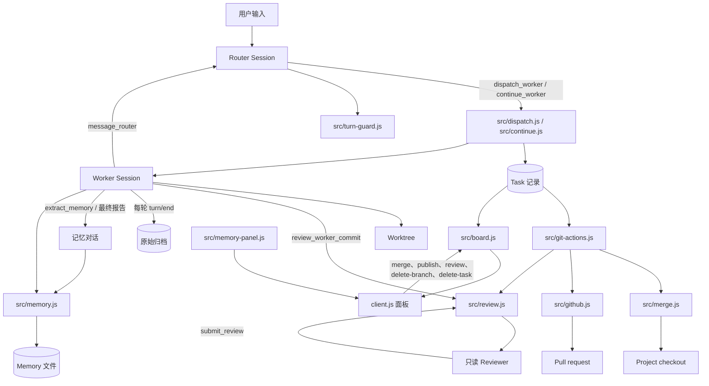

# 007 架构

这份文档把 [001 领域模型](001-domain.md) 的概念映射到文件、服务和数据。先读「核心流程」和「依赖规则」，再把「模块」与「测试」两张表当索引用。它建立在 [000 原则](000-philosophy.md) 到 [006 部署](006-deployment.md) 之上。

## 核心流程

Host 插件 `index.js` 管理 Worker 生命周期和面板路由；Router 插件 `router.js` 注册路由工具、合并命令和 Router 记忆工具。两个入口都通过 `ctx` 使用 DSH 服务，源文件不 import DSH 包（`index.js:13-154`、`router.js:1-14`）。

## 核心模块

### `index.js`

Host 生命周期入口。`agent/created` 为 Worker Session 找到 Task，把 `starting` 或 `resuming` 改为 `running`，安装工具守卫，按条件注册 `create_worktree`、`review_worker_commit`、记忆、提取、消息和报告工具（`index.js:42-93`）。它为已认领的 Reviewer 注册 `submit_review`，注册 `/superagent-lite/tasks`、`/superagent-lite/git`、`/superagent-lite/memory` 三个路由，并在启动时刷新 profile（`index.js:16`、`index.js:18-31`）。

`subagent/end` 落定 change 任务：`review-required`、`awaiting-merge`、`failed` 或 `delivery-blocked`；report 任务未交报告则 `failed`（`index.js:114-146`）。`session/event` 的 `turn/end` 触发 Worker 轮次归档（`index.js:107-111`）。它不决定路由，也不编辑项目文件。

### `router.js`

注册 `dispatch_worker`、`continue_worker`、`/merge-worker` 和 Router 的 `superagent_memory`，并注册 profile 运行时上下文（`router.js:8-14`）。它不持有 Task 记录。

### `src/task-store.js`

Task JSON 的唯一存储模块。默认根目录 `~/.dsh/superagent-lite`，创建 `tasks/` 和 `tasks/sessions/`；记录以 `0600` 原子写入，按根和键串行化；创建时强制 Team 与 Project 一对一；提供 Session ID 到 Task 的反查（`src/task-store.js:34-138`）。

### `src/dispatch.js`

校验参数，从 Router agent 与 call ID 派生 Task ID，读取项目根、base commit、base branch 和工作区状态，写 `starting` 记录，建立 Session 映射，调用 `ctx.subagents.startActivation`。启动失败把 Task 标为 `failed`（`src/dispatch.js:46-112`）。

### `src/continue.js`

把 follow-up 送给运行中的 Worker 或空闲 Worker。运行中发短更新；空闲时发精简续派发消息（任务标识、不可变规则、唯一权威的 Follow-up），仅在检测到上下文压缩时回放原需求。已结束的 Task 先改 `resuming` 并清空旧 Review；follow-up 先记录，发送失败回滚（`src/continue.js:1-153`）。

压缩检测读取 Worker Session 的推导消息，找 `compact-checkpoint` 来源；活着的 Worker 直接读 Session，未加载的 Worker 通过 `ctx.sessionQuery.inspectSession` 读取持久化会话，不重新挂载。两个入口都不可用时保守地不回放原需求。

### `src/worker-prompt.js`

生成 change 和 report 两种任务消息。它统一 `Project team`、`Base branch`、`Task`、`Requirements`、模式段和 `Before` / `During` / `After` / `Reporting` 段（`src/worker-prompt.js:1-69`）。

### `src/turn-guard.js`

按 Session 和回合统计用户输入与成功的派发决定。完成回合没有决定时，在 idle 后插入提醒；每个输入最多 2 次；只对 `superagent-lite` 预设生效（`src/turn-guard.js:1-133`）。

### `src/worktree-tool.js`

通过 `ctx.worktrees.create` 从 base commit 创建 Worktree，保存 `path`、`branch`、`baseCommit`、`repositoryRoot`、`sourceBranch`，并把 Worker 工作目录切过去。第二次调用只重新进入（`src/worktree-tool.js:23-62`）。

### `src/landing.js`

保存每个 Task 的落地状态：dispatch 写入 `land`，create_worktree 写入分支，review 与面板写入 reviewed HEAD，continue 可追加授权。`index.js` 的 shell guard 用它检查 `git push`、`git merge`、`gh pr create` 和 `gh pr merge`；未授权、未审查或越界时返回拒绝原因（`src/landing.js:1-417`）。

### `src/review.js`

提供 `worktreeHead`：检查仓库根、分支、干净工作区和 HEAD（`src/review.js:42-52`）。`runReview` 检查净改动，创建审查范围，启动只读 Reviewer，从 Reviewer 的 `submit_review` 取回裁决（内容「通过」是通过，其他内容记为意见），校验证据并复核 HEAD 后写入 Review（`src/review.js:12-34`、`src/review.js:69-123`）。`review_worker_commit` 和面板的审查动作共用 `runReview`；Reviewer 的提示词不包含 diff（`src/review.js:54-67`）。

### `src/review-scope.js`

定义 Reviewer 的「改动」范围：Worktree 加 `base..head`。它校验文件路径、符号链接、`.git`、绝对路径、git 子命令、版本参数、flag、只读命令和 workdir，并记录是否真的读过 diff 或改动文件（`src/review-scope.js:1-231`）。

### `src/helper-guard.js`

维护待认领 helper 队列，安装只读 guard。Reviewer 和记忆对话继承 Worker 工具集，因此 guard 把 shell 限制在只读模式。没有审查范围时放行只读工具集（`structured_output`、`read`、`read_image`、`glob`、`grep`、`read_page`、`web_fetch`、`web_search`、`x_search`、`job_output`、`job_list`）和受限 shell；带审查范围时进一步收窄到 `structured_output`、`read`、`read_image`、`glob`、`grep`、`bash`、`pwsh`，再套 `review-scope`（`src/helper-guard.js:4-23`、`src/helper-guard.js:73-107`）。

### `src/memory.js`

构建 `superagent_memory`、`extract_memory`、面板 facade、profile 上下文和轮次归档。它把 Session 角色映射为可访问分类，给每次写入记录来源事件，profile 写入后刷新注入；记忆对话只收到选定结论，插件负责把四类结果写回（`src/memory.js:1-228`）。

### `src/memory-extractor.js`

只定义记忆对话角色：标签、5,000 字符 findings 上限、500 字符单条上限、四类数量上限、输出 schema 和提示词（`src/memory-extractor.js:1-41`）。

### `src/memory-panel.js`

提供 `GET` / `POST /superagent-lite/memory`。只允许 owner，校验 action、category、记录 ID 和字段；body 上限 32 KB；把缺失记录映射为 `404`，存储拒绝映射为 `400` 或 `409`（`src/memory-panel.js:1-94`）。

### `src/memory-store.js`

保存 Memory 记录和原始归档。负责分类与 scope 校验、team 分区哈希、按规范化文本相似度去重与覆盖、`0600` 原子写、更新串行、拒绝符号链接、按 Session 与序号保存不可变归档；`panel.teams()` 只供 owner 面板列出 team 分区（`src/memory-store.js:1-440`）。

### `src/merge.js`

实现本地合并、分支删除和 `/merge-worker`。`mergeWorkerBranch` 检查 reviewed HEAD、目标分支、干净 checkout 和 `merge-tree` 预检，切到所选目标，执行 `git merge --no-ff`，复核目标后切回，记录 `merging`、`merged` 或 `delivery-blocked`（`src/merge.js:30-103`）。同一 Project 根的合并和删除在此排队，面板与 `/merge-worker` 不会同时切换共享 checkout；`deleteWorkerBranch` 移除已合并的 Worktree 并删除分支（`src/merge.js:14-26`、`src/merge.js:107-136`）。`/merge-worker` 用同一合并逻辑处理 Task 的 base branch（`src/merge.js:138-163`）。

### `src/git-actions.js`

推导每个 Task 的六个面板状态，采纳同一 commit 由另一个 Task 记录的通过审查，读取本地分支、remote 和 `gh` 账号，并执行面板的 `merge`、`publish`、`review` 和 `delete-branch`。它缓存 PR 事实 30 秒，把精确 PR 状态同步进 Task，检查 reviewed HEAD、目标和 remote，按 Task 串行化动作；状态推导和审查索引在 `src/status.js`（`src/git-actions.js:66-550`）。

### `src/github.js`

把 remote URL 解析为 GitHub 仓库，把 reviewed commit 推送到所选 remote，打开或复用针对 base branch 的 PR，并复核精确 HEAD 和 base。它是唯一的 GitHub 写路径（`src/github.js:1-137`）。

### `src/process.js`

通过 `ctx.subprocess` 运行 `git` 和 `gh`，过滤 `GIT_*` 和 `GH_DEBUG` 环境，禁用提示和 hooks，限制输出 65,536 字节（`src/process.js:7-36`）。同步 `runCommandSync` 只供 worker shell guard 在命令执行前读取分支和 HEAD（`src/process.js:38-48`、`src/landing.js:71-80`）。

### `src/board.js`

提供 `GET /superagent-lite/tasks`、`DELETE /superagent-lite/tasks?taskId=`、`GET /superagent-lite/git?taskId=` 和 `POST /superagent-lite/git`。只允许 owner，投影公开 Task 字段，叠加推导出的面板状态，标记 `unconfirmed`，拒绝删除运行中的 Task 并删除记录与 worker 会话映射，限制 JSON body 4 KB，校验合并目标或 PR remote，并把动作拒绝映射为 `409`；同时导出记忆端点复用的 body reader（`src/board.js:1-148`）。

### `src/report-tool.js`

结束 report 任务：检查活跃 Worker、report 模式、没有 Worktree、HEAD 仍在 base commit、checkout 未变，把结论和证据发给 Router，并写入 `completed`（`src/report-tool.js:1-44`）。

### `src/message-router.js`

把 Worker 的最终结论发给 Router，要求活跃 Worker 和 1–4,000 字符文本；送达后调用可选回调，触发最终报告记忆提取（`src/message-router.js:1-27`）。

### `client.js`

浏览器面板。注册 `main` 和 `sidebar.panellist` 槽位与 `superagent-lite` 字典；加载任务和记忆，按六个面板状态分组和过滤，按 Team/Project 缩小任务，渲染会话和 PR 链接，提交 merge、publish、review、delete-branch 和 delete-task 动作。合并弹窗选择本地目标分支；提交 PR 弹窗检查 `gh` 账号并选择 remote；审查从 Worker Session 启动；删除分支弹窗确认分支和工作树移除；删除任务弹窗确认移除面板记录。记忆按分类和文本过滤，编辑或删除需 owner 点击（`client.js:1-845`）。它不 import Node 模块，状态只在 React 内。

## 依赖规则

- `index.js` 和 `router.js` 是唯一插件入口。`src/` 不 import 这两个入口或 `client.js`。
- `client.js` 只在浏览器运行，通过模块加载器使用 `react`、`slots` 和 `locale`。
- 没有源文件 import `@deepseek-ai/*` 包。Host 能力通过 `ctx` 服务提供：`subagents`、`tools`、`worktrees`、`subprocess`、`agents`、`agentPresets`、`sandboxPolicy`、`workingDirectory`、`systemPrompt`、`webServer`、`connection`、`commands`（`index.js:13`、`router.js:6`）。
- `src/process.js` 是唯一进程启动器；所有 `git` 和 `gh` 调用经它执行（`src/process.js:7-35`）。
- `src/task-store.js` 是唯一 Task 记录存储模块；其他模块调用 `createTask`、`updateTask`、`readTask`、`removeTask`、`listTasks`、`linkWorkerSession` 或 `taskForSession`（`src/task-store.js:157-161`）。
- `src/memory-store.js` 是唯一 Memory 与归档存储模块；模型工具、记忆对话和面板都经过它的 facade（`src/memory-store.js:435-439`）。
- `src/memory-panel.js` 是唯一记忆面板端点；它复用 `src/board.js` 的 `readJsonBody`，不从请求读路径（`src/memory-panel.js:1-2`）。
- `src/memory-extractor.js` 只持有提示词和上限，不拥有 store 或 Session（`src/memory-extractor.js:1-41`）。
- `src/helper-guard.js` 是唯一 helper 计数器和只读 guard 安装者（`src/helper-guard.js:25-107`）。
- `src/github.js` 和 `src/merge.js` 是面板与 `/merge-worker` 的交付写路径；授权 Worker 的 shell 落地由 `index.js` 的 guard 经 `src/landing.js` 检查（`src/github.js:77-137`、`src/merge.js:30-136`、`src/landing.js:387-417`）。
- `src/status.js` 是唯一把存储状态、Git 事实和审查记录变成面板状态的地方（`src/status.js:6-49`）。

### 状态写者

| 转换 | 写者 |
| --- | --- |
| → `starting` | `src/dispatch.js` |
| → `running`，agent 创建后 | `index.js` |
| → `running`，Worktree 保存后 | `src/worktree-tool.js` |
| → `resuming` | `src/continue.js` |
| → `review-required` | `index.js` |
| → `awaiting-merge` | `index.js`；`src/git-actions.js` 在读取时修正 |
| → `merging` | `src/merge.js` |
| → `merged`，本地合并 | `src/merge.js` |
| → `merged`，精确 PR 已合并 | `src/git-actions.js` |
| → `merged`，worker HEAD 已包含在基础分支 | `src/git-actions.js`，读取时；HEAD 不是基础 commit，且存储状态属于交付状态 |
| → `publishing` | `src/git-actions.js` |
| → `awaiting-ci` | `src/github.js`；`src/git-actions.js` 在读取时修正 |
| → `delivery-blocked`，审查后 HEAD 检查失败 | `index.js` |
| → `delivery-blocked`，发送失败 | `src/git-actions.js` |
| → `delivery-blocked`，本地合并失败 | `src/merge.js` |
| → `delivery-blocked`，精确 PR 关闭 | `src/git-actions.js` |
| `review` 记录，面板审查后 | `src/git-actions.js` 经 `src/review.js` |
| `worktree` 清空，删除分支后 | `src/merge.js` |
| → `completed` | `src/report-tool.js` |
| → `failed`，派发失败 | `src/dispatch.js` |
| → `failed`，Worker 回合失败 | `index.js` |
| → `failed`，follow-up 发送失败 | `src/continue.js` |
| `unconfirmed` | `src/board.js`，只在读取时计算 |

## 模块

| 路径 | 职责 |
| --- | --- |
| `src/board.js` | 提供 owner-only 任务列表、任务删除与 Git 动作 HTTP 端点，并投影面板视图。 |
| `src/status.js` | 推导六个面板状态，并按 Project 与 commit 索引通过的审查。 |
| `src/continue.js` | 把 follow-up 送给运行中或空闲 Worker，处理恢复记录和发送失败回滚。 |
| `src/dispatch.js` | 校验派发、创建 Task 记录并启动 Worker Session。 |
| `src/git-actions.js` | 构建面板视图，执行合并、发送 PR、审查和删除分支动作。 |
| `src/github.js` | 把 reviewed commit 交付到所选 GitHub remote 的 Pull request。 |
| `src/helper-guard.js` | 计数待认领 helper，并把它们限制在只读工具和审查范围内。 |
| `src/landing.js` | 持有 Task 的落地授权与 reviewed HEAD，检查 Worker shell 的 push、PR 与 merge 范围。 |
| `src/memory.js` | 注册记忆工具、profile 上下文、记忆对话、面板 facade 和轮次归档。 |
| `src/memory-extractor.js` | 定义记忆对话的角色提示词、标签、四类上限和输出 schema。 |
| `src/memory-panel.js` | 提供 owner-only 记忆列表、编辑和删除 HTTP 端点。 |
| `src/memory-store.js` | 保存 Memory 记录和原始归档，执行分类、scope、密钥检查以及写入去重/纠错。 |
| `src/merge.js` | 实现本地 `--no-ff` 合并、分支删除和 `/merge-worker` 命令。 |
| `src/message-router.js` | 把 Worker 的最终结论发给 Router，并触发最终报告记忆提取。 |
| `src/process.js` | 以过滤环境和有界输出运行 git 与 gh。 |
| `src/report-tool.js` | 以结论和证据结束 report 任务。 |
| `src/review.js` | 检查已提交 diff，运行只读 Reviewer，接收 `submit_review` 并记录裁决。 |
| `src/review-scope.js` | 定义 Reviewer 可读的 Worktree 与 `base..head` 范围并执行放行检查。 |
| `src/task-store.js` | 读写 Task 记录和 Worker Session 映射，删除记录与映射。 |
| `src/turn-guard.js` | 要求 Router 每个输入一个派发决定并发送提醒。 |
| `src/validation.js` | 校验派发参数。 |
| `src/worker-prompt.js` | 生成 change 和 report 任务消息。 |
| `src/worktree-tool.js` | 创建或进入 Task 的 Worktree，并保存元数据。 |

## 测试

| 测试 | 覆盖什么 |
| --- | --- |
| `test/board.test.js` | owner 准入、公开字段投影、推导面板状态、任务删除、动作校验和状态码。 |
| `test/client.test.js` | 槽位注册、中英渲染、六状态分组与筛选、会话导航、合并/提交 PR/审查/删除分支/删除任务弹窗、记忆搜索与编辑删除和错误。 |
| `test/continue.test.js` | 运行中、空闲和已结束 Task 的 follow-up 路径、精简续派发结构、压缩回放、记录顺序和发送失败回滚。 |
| `test/git-actions.test.js` | 推导状态、审查采纳、本地合并与分支删除、remote 选择、面板审查和 PR 状态同步。 |
| `test/github.test.js` | GitHub 仓库解析和 reviewed SHA 发送。 |
| `test/helper-composition.test.js` | 已安装 DSH 服务下的 helper 边界和只读沙箱。 |
| `test/helper-guard.test.js` | helper 认领、只读工具白名单和 shell 限制。 |
| `test/helper-wiring.test.js` | `agent/created` 只为预期 helper 安装只读守卫。 |
| `test/host-patch.test.js` | agent-message 任务卡 Host 补丁的检查、重复应用和回滚。 |
| `test/host.test.js` | 已安装 DSH 集成：schema、Worktree、Review、合并、记忆和归档。 |
| `test/landing.test.js` | 未授权与授权后的 push/PR/merge 检查、分支与 reviewed HEAD 范围、跨任务授权和伪造授权。 |
| `test/landing-wiring.test.js` | Worker shell guard 的安装、真实拒绝与放行、跨任务隔离。 |
| `test/memory-extractor.test.js` | 记忆角色提示词、四类提取、重复提取复用记录、空结果、超限事实和面板编辑删除。 |
| `test/memory-panel.test.js` | owner 准入、记忆投影、更新/删除路径、body 校验和状态码映射。 |
| `test/memory-store.test.js` | 分类、team scope、private 引用、面板 team scope、归档不可变、符号链接和并发更新。 |
| `test/memory-write-rules.test.js` | 相同写入不新增、等价改写不新增、错误记忆覆盖更新、新内容新增、并发相同写入，以及分类和 scope 隔离。 |
| `test/memory-wiring.test.js` | 最终报告触发提取、显式提取抑制和提取失败不影响报告。 |
| `test/preset-injection.test.js` | Router 预设挂载 agent instructions，Worker 预设保留自己的配置。 |
| `test/process.test.js` | git/gh 默认 65,536 字节上限、自定义上限和超限报错。 |
| `test/prompt-config.test.js` | Router 提示词的回复、合并授权，以及提示词与文档的一致性。 |
| `test/report-only.test.js` | report 任务的完成、无分支提交、伪造 Worktree 拒绝和报告提示词。 |
| `test/review-scope.test.js` | Reviewer 文件读取、符号链接和只读命令的范围限制。 |
| `test/review.test.js` | Reviewer 提示词带范围不带 diff、无证据裁决被拒、读改动文件算证据。 |
| `test/routing-rule.test.js` | 两个路由工具把不同目标挡在 `continue_worker` 外，persona 说明新工作规则。 |
| `test/status.test.js` | 六个面板状态、优先级和审查索引。 |
| `test/task-store.test.js` | Task 记录私有写入、Session 反查、删除记录与映射和路径形 ID 拒绝。 |
| `test/turn-guard.test.js` | 每个输入一个决定、提醒预算、idle 投递和中止处理。 |
| `test/validation.test.js` | 派发参数规则和 mode 默认值。 |
| `test/wiring.test.js` | `apply` 把 `turn/end` 与 idle 接到派发提醒。 |
| `test/worker-prompt.test.js` | change 与 report 任务消息、段顺序和范围限制。 |

## 持久化

Task 与 Memory 记录在 `~/.dsh/superagent-lite/`，Worktree 在各项目下。

| 记录 | 路径 | 写者 |
| --- | --- | --- |
| Task | `tasks/<id>.json` | `src/task-store.js` |
| Worker Session 映射 | `tasks/sessions/<sha256(sessionId)>.json` | `src/dispatch.js` 通过 `linkWorkerSession` |
| private 记忆 | `memory/private/<uuid>.json` | `src/memory-store.js` |
| public 记忆 | `memory/public/<uuid>.json` | `src/memory-store.js` |
| profile 记忆 | `memory/profile/<uuid>.json` | `src/memory-store.js` |
| team 记忆 | `memory/team/<hash>/<uuid>.json` | `src/memory-store.js` |
| 原始轮次归档 | `memory/archive/<hash>.json` | `src/memory.js` 通过 `archiveWorkerTurn` |
| Worktree | `<project>/.agents/worktrees/` | worktree 服务 |

team 分区哈希覆盖 Team ID 和规范化后的 Project 根；归档哈希覆盖 Session ID 和轮次结束序号。目录以 `0700` 创建，记录以 `0600` 写入（`src/memory-store.js:247-253`、`src/task-store.js:34-57`、`src/memory-store.js:405-433`）。

## 对外接口

| 工具 | 调用方 | 用途 |
| --- | --- | --- |
| `dispatch_worker` | Router | 记录派发决定，必要时启动 Worker |
| `continue_worker` | Router | 给同一 Task 发 follow-up |
| `superagent_memory` | Router、Worker | 按分类读写记忆 |
| `/merge-worker` | 用户 | 按 Task ID 授权一次本地合并 |
| `create_worktree` | change worker | 创建或进入 Task 的 Worktree |
| `review_worker_commit` | change worker | 审查干净的已提交 diff |
| `submit_review` | Reviewer helper | 记录裁决；内容「通过」即通过 |
| `report_task` | report worker | 结束 report 任务并交回结论 |
| `message_router` | Worker | 把最终结论发给 Router，并触发最终报告记忆提取 |
| `extract_memory` | Worker | 用记忆对话把选定结论提炼成四类记忆 |

| 端点 | 方法 | 用途 |
| --- | --- | --- |
| `/superagent-lite/tasks` | `GET` | 返回 owner 可见的 Task 列表和推导出的面板状态 |
| `/superagent-lite/tasks` | `DELETE` | 删除一个已结束 Task 的记录和 worker 会话映射 |
| `/superagent-lite/git` | `GET` | 返回一个 Task 的提交、改动文件、本地分支、remote 和 `gh` 账号 |
| `/superagent-lite/git` | `POST` | 执行 `merge`、`publish`、`review` 或 `delete-branch` |
| `/superagent-lite/memory` | `GET`、`POST` | 列出记忆，或执行 `update` / `delete` |

| 接口 | 值 |
| --- | --- |
| 侧栏槽位 | `sidebar.panellist`，面板标签「项目任务」 |
| 主槽位 | `main` |
| Locale 命名空间 | `superagent-lite` |
| 包导出 | `.`、`./router`、`./locale/*.json`、`./icon`、`./client` |
| DSH bundle patch | `./cordis.patch.yml` |
| DSH client | Web 平台、立即注入，依赖 layout、sidebar、workspace 和 locale |

## 配置更新

| 变更 | 生效时机 |
| --- | --- |
| `cordis.patch.yml` | 下一次 bundle 加载 |
| `src/` 里的工具文字 | bundle 加载后的下一次拼装回合 |
| `src/memory-extractor.js` 角色文字 | 下一次记忆提取启动 |
| `client.js` 字典 | 下一次客户端 bundle 加载 |
| profile 记忆写入 | 立即刷新注入的 profile 上下文 |
| Task 或 Memory 记录 | 下一次面板加载或工具调用；面板会修正已审查的 HEAD 并采纳同一 commit 的审查 |
| 记忆写入 | 立即写入磁盘；同一分类与 scope 内相同或等价的事实不新增，纠正覆盖匹配记录 |
| 面板记忆编辑或删除 | 立即写入磁盘和面板；下一次工具调用读到新记录 |
| GitHub remote 与 PR 事实 | PR 事实缓存 30 秒；面板刷新在缓存过期后重新读取 |

profile 上下文以 order `170` 注册，在 Host 组装模型调用的运行时上下文时读取（`src/memory.js:20-22`）。
