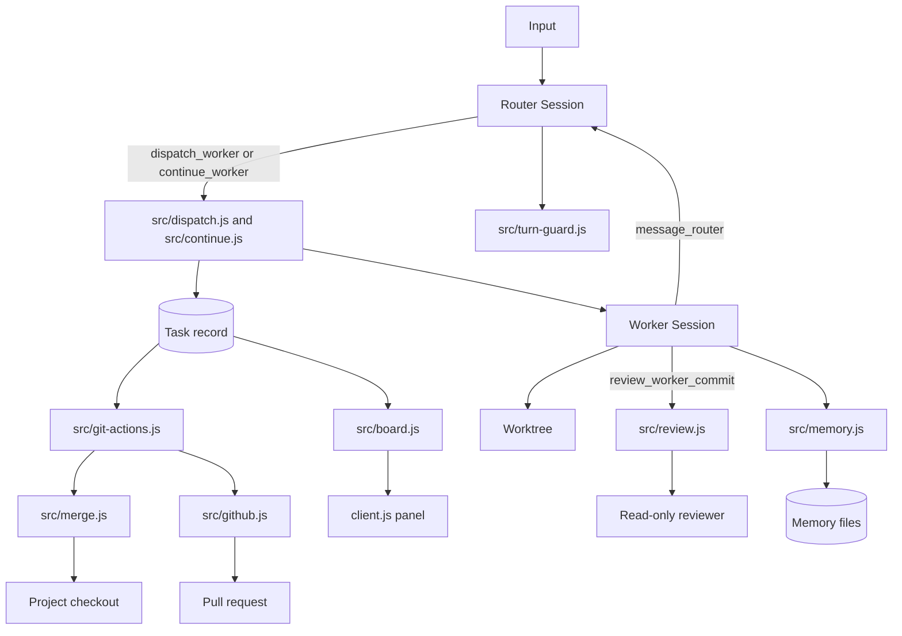

# 007 Architecture

This document maps the concepts to files and services, and names the rules that keep them apart. It builds on [001 Domain model](001-domain.md) through [006 Deployment](006-deployment.md). The module and test tables at the end are the index into the source tree.

## Core flow

The Host plugin `index.js` owns the worker lifecycle and the panel routes. The router plugin `router.js` registers the routing tools, the merge command and the router memory tool. Both entry points sit on DSH services; no source file imports a DSH package.

## Core modules

### `index.js`

Owns the Host lifecycle. On `agent/created` it finds the Task for the new worker Session, marks `starting` or `resuming` as `running`, installs the tool guard, and registers `create_worktree`, `review_worker_commit`, memory, extraction, message and report tools under `when` conditions. On `subagent/end` it settles the Task as `review-required`, `awaiting-merge`, `failed` or `delivery-blocked`. It registers the two panel HTTP routes and the profile context refresh. It does not decide routing and does not edit project files.

### `router.js`

Registers `dispatch_worker`, `continue_worker`, `/merge-worker` and the router's `superagent_memory`. Its inject list covers `tools`, `subagents`, `workingDirectory`, `subprocess`, `worktrees`, `commands`, `sandboxPolicy`, `systemPrompt` and `agentPresets`, and it mounts the profile context. It owns no Task record.

### `src/task-store.js`

The only writer of task JSON. It derives paths from `~/.dsh/superagent-lite`, creates `tasks/` and `tasks/sessions/`, writes records atomically at mode `0600`, serializes writes per root and key, and enforces the one-to-one Team and Project assignment. It also resolves a worker Session ID to its Task.

### `src/dispatch.js`

Validates the call, derives the 16-hex Task ID from the router agent and tool call, reads the project root, base commit, base branch and working-tree state, writes the `starting` record, links the worker Session and calls `ctx.subagents.startActivation`. A start failure settles the Task as `failed`.

### `src/validation.js`

Checks `delegate`, `reason`, `teamId`, `title`, `task` and `mode`. It returns the trimmed values used by `dispatch.js`.

### `src/continue.js`

Delivers a follow-up either as a short update to a running worker or as the full `buildWorkerPrompt` message plus a `Resume` section to an idle worker. It marks a settled Task `resuming`, clears the old review record, records the follow-up before sending, and rolls the record back on a failed delivery.

### `src/worker-prompt.js`

Builds the task message for a change or report task. It is the single source of the `Project team`, `Base branch`, `Task`, `Requirements`, `Before`, `During`, `After` and `Reporting` sections.

### `src/turn-guard.js`

Counts user inputs and successful routing decisions per turn. A completed router turn without a decision gets a reminder after idle, at most twice per input. It ignores other presets and aborted turns.

### `src/worktree-tool.js`

Creates the Worktree through `ctx.worktrees.create` on branch `sl-<team-slug>-<taskId>` from the base commit, saves its metadata on the Task, and moves the worker's working directory into it. A second call re-enters the existing Worktree.

### `src/review.js`

Owns `worktreeHead`, which checks the repository root, branch, clean tree and HEAD. `review_worker_commit` checks the committed diff, starts the read-only reviewer, records the verdict and re-checks the head. The reviewer receives the stored requirements, follow-ups, head and patch.

### `src/helper-guard.js`

Keeps the pending-helper counter and installs the read-only guard. It appends the read-only sandbox mode to the helper Session, admits the read-only tool set, and admits `bash` or `pwsh` only when the shell confines file writes and the call does not widen the sandbox.

### `src/memory.js`

Builds `superagent_memory`, `extract_team_memory`, the profile context and the turn archive. It maps the Session role to the allowed categories, records the source event for every write, refreshes the profile after a profile write, and sends only selected findings to the extraction helper.

### `src/memory-store.js`

Stores memory records and raw turn archives. It owns category and scope checks, team partition hashing, atomic `0600` writes, serialized updates, symlink refusal and the immutable archive keyed by Session and sequence.

### `src/merge.js`

Owns `/merge-worker`. It validates the Task ID, ownership, full-access policy, non-GitHub origin, `awaiting-merge` state, approved review, target branch, clean target, absent in-progress merge and conflict-free `merge-tree` preflight, then runs `git merge --no-ff` and records `merging`, `merged` or `delivery-blocked`.

### `src/git-actions.js`

Lists the Git view for each Task and performs the panel's `merge` or `publish` action. It caches origin and Pull request facts for 30 seconds, reconciles an exact PR state into the Task, checks the reviewed head and target, and refuses an action when the router Session is missing or not full access.

### `src/github.js`

Detects a strict GitHub origin and delivers a reviewed commit. It pushes the reviewed head, opens or adopts the Pull request for that head, and on merge runs `gh pr merge --merge --match-head-commit`, then fast-forwards the project checkout. It re-checks the exact head and base and is the only GitHub write path.

### `src/process.js`

Runs `git` and `gh` through `ctx.subprocess` with a filtered environment, prompt disabled and bounded output. Git calls disable hooks. It is the only module that spawns a process.

### `src/board.js`

Serves `GET /superagent-lite/tasks` and `POST /superagent-lite/git`. It admits only the installation owner, projects the public task fields, overlays the Git view, computes `unconfirmed`, enforces the JSON body limit and maps a refused action to `409`.

### `src/report-tool.js`

Ends a report-only Task. It checks the active worker, report mode, absence of a Worktree, the unchanged base commit and the unchanged checkout, sends the conclusion and evidence to the router, and stores `completed`.

### `src/message-router.js`

Sends the worker's one final conclusion to the router. It requires the active worker for the Task and a message of 1–4,000 characters.

### `client.js`

The browser panel. It registers the `main` and `sidebar.panellist` slots and the `superagent-lite` locale dictionaries, loads the task list, groups and filters tasks by the five status categories, filters by team and project, renders session and Pull request links, and posts the Git actions. Git delivery is a supporting list with no second state model. It imports no Node module and holds no state outside React.

## Dependency rules

- `index.js` and `router.js` are the only plugin entry points. No module under `src/` imports either entry point or `client.js`.
- `client.js` runs only in the browser. It uses the module loader's `react` and the `slots` and `locale` services.
- No source file imports an `@deepseek-ai/*` package. Host capabilities arrive through `ctx` services: `subagents`, `tools`, `worktrees`, `subprocess`, `agents`, `agentPresets`, `sandboxPolicy`, `workingDirectory`, `systemPrompt`, `webServer`, `connection`, `commands`.
- `src/process.js` is the only process spawner. Every git and gh call goes through it.
- `src/task-store.js` is the only task-record writer. Every other module calls `createTask`, `updateTask`, `readTask`, `listTasks`, `linkWorkerSession` or `taskForSession`.
- `src/helper-guard.js` is the only helper counter and the only read-only guard installer.
- `src/github.js` and `src/merge.js` are the only delivery paths. No other module pushes, creates a Pull request or merges.

### Transition writers

| Transition | Writer |
| --- | --- |
| → `starting` | `src/dispatch.js` |
| → `running` after the agent is created | `index.js` |
| → `running` after the Worktree is saved | `src/worktree-tool.js` |
| → `resuming` | `src/continue.js` |
| → `review-required` | `index.js` on `subagent/end` |
| → `awaiting-merge` | `index.js` on `subagent/end` |
| → `merging` | `src/merge.js` |
| → `merged` after a local merge | `src/merge.js` |
| → `merged` after reading an exact PR | `src/git-actions.js` |
| → `merged` or `merge-queued` after GitHub delivery | `src/github.js` |
| → `publishing` | `src/git-actions.js` |
| → `awaiting-ci` | `src/github.js` |
| → `delivery-blocked` after the post-review head check | `index.js` |
| → `delivery-blocked` after a publish failure | `src/git-actions.js` |
| → `delivery-blocked` after an exact PR closes | `src/git-actions.js` |
| → `delivery-blocked` after a merge command failure | `src/merge.js` |
| → `completed` | `src/report-tool.js` |
| → `failed` after a dispatch start failure | `src/dispatch.js` |
| → `failed` after a worker turn | `index.js` |
| → `failed` after a follow-up delivery failure | `src/continue.js` |
| `unconfirmed` | `src/board.js`, at read time only |

## Modules

| Path | Responsibility |
| --- | --- |
| `src/board.js` | Serves the owner-only task list and Git action HTTP endpoints and projects the panel view. |
| `src/continue.js` | Delivers follow-ups to running or idle workers and handles resumption records. |
| `src/dispatch.js` | Validates a dispatch, creates the Task record and starts the Worker Session. |
| `src/git-actions.js` | Builds the Git branch view and performs the merge and publish actions. |
| `src/github.js` | Detects a GitHub origin and delivers a reviewed commit through a Pull request. |
| `src/helper-guard.js` | Counts expected helper subagents and confines them to read-only tools. |
| `src/memory.js` | Registers the memory tools, profile context and turn archive. |
| `src/memory-store.js` | Persists memory records and raw archives with scope and secret checks. |
| `src/merge.js` | Implements the `/merge-worker` command and the local `--no-ff` merge. |
| `src/message-router.js` | Sends one final worker conclusion to the router Session. |
| `src/process.js` | Spawns git and gh with a filtered environment and bounded output. |
| `src/report-tool.js` | Ends a report-only Task with its conclusion and evidence. |
| `src/review.js` | Checks the committed diff, runs the read-only reviewer and records the verdict. |
| `src/task-store.js` | Reads and writes task records and worker Session links. |
| `src/turn-guard.js` | Requires one routing decision per router input and sends reminders. |
| `src/validation.js` | Validates dispatch arguments. |
| `src/worker-prompt.js` | Builds the change and report task messages. |
| `src/worktree-tool.js` | Creates or enters the Task's Worktree and stores its metadata. |

## Entry files

| Path | Responsibility |
| --- | --- |
| `index.js` | Host plugin: worker lifecycle, tool registration and panel routes. |
| `router.js` | Router plugin: routing tools, merge command and router memory. |
| `client.js` | Browser panel. |
| `cordis.patch.yml` | Bundle composition: worktree service, presets and tool rows. |
| `package.json` | Package exports, test script, DSH bundle and client declarations. |
| `locale/en.json` | English plugin metadata. |
| `locale/zh.json` | Chinese plugin metadata. |
| `icon.svg` | Plugin icon. |

## Tests

| Test | Covers |
| --- | --- |
| `test/board.test.js` | Owner admission, public task projection, Git overlay, endpoint status codes. |
| `test/client.test.js` | Slot registration, localized rendering, five-category grouping and filters, session navigation, Git delivery actions and errors. |
| `test/continue.test.js` | Running, idle and settled follow-up paths, record order and delivery failures. |
| `test/git-actions.test.js` | Branch view, merge and publish eligibility, PR reconciliation and router access. |
| `test/github.test.js` | Strict origin parsing, required checks and reviewed-SHA pinning. |
| `test/helper-composition.test.js` | Installed DSH services enforce the helper boundary and read-only sandbox. |
| `test/helper-guard.test.js` | Helper claims, read-only tool allowlist and shell confinement. |
| `test/helper-wiring.test.js` | `agent/created` installs the guard only for an expected helper. |
| `test/host.test.js` | Installed DSH integration: schemas, worktree, review, merge, memory and archive. |
| `test/memory-store.test.js` | Categories, team scopes, private references, archive immutability, symlink refusal and concurrent updates. |
| `test/prompt-config.test.js` | Bundled router prompt keeps replies single and concrete, and the merge-authorization policy matches across the prompt and docs. |
| `test/report-only.test.js` | Report-only completion, no branch or commit, forged worktree refusal and report prompt. |
| `test/routing-rule.test.js` | Routing tool descriptions keep a different goal out of `continue_worker`. |
| `test/task-store.test.js` | Private task records, Session resolution and path-shaped ID rejection. |
| `test/turn-guard.test.js` | One decision per input, reminder budget, idle delivery and abort handling. |
| `test/validation.test.js` | Dispatch argument rules and mode default. |
| `test/wiring.test.js` | `apply` wires `turn/end` and idle into the dispatch reminder. |
| `test/worker-prompt.test.js` | Change and report task messages, section order and scope limits. |

## Persistence

Task and Memory records live under `~/.dsh/superagent-lite/`. Worktrees live under each project.

| Record | Path | Writer |
| --- | --- | --- |
| Task | `tasks/<id>.json` | `src/task-store.js` |
| Worker Session link | `tasks/sessions/<sha256(sessionId)>.json` | `src/dispatch.js` through `linkWorkerSession` |
| Public memory | `memory/public/<uuid>.json` | `src/memory-store.js` |
| Profile memory | `memory/profile/<uuid>.json` | `src/memory-store.js` |
| Private memory | `memory/private/<uuid>.json` | `src/memory-store.js` |
| Team memory | `memory/team/<hash>/<uuid>.json` | `src/memory-store.js` |
| Raw turn archive | `memory/archive/<hash>.json` | `src/memory.js` through `archiveWorkerTurn` |
| Worktree | `<project>/.agents/worktrees/` | The worktree service |

The team partition hash covers the Team ID and the normalized project root. The archive hash covers the Session ID and the turn-end sequence. Directories are created at mode `0700` and records at `0600`.

## External interfaces

| Tool | Caller | Purpose |
| --- | --- | --- |
| `dispatch_worker` | Router | Record the routing decision and optionally start a worker |
| `continue_worker` | Router | Send a follow-up to the same Task |
| `superagent_memory` | Router, worker | Read and write saved facts by category |
| `/merge-worker` | User | Authorize one local merge by Task ID |
| `create_worktree` | Change worker | Create or enter the Task's Worktree |
| `review_worker_commit` | Change worker | Review the clean committed diff |
| `report_task` | Report worker | End a report-only Task |
| `message_router` | Worker | Send the final conclusion to the router |
| `extract_team_memory` | Worker | Distill selected findings into team memory |

| Endpoint | Method | Purpose |
| --- | --- | --- |
| `/superagent-lite/tasks` | `GET` | Return the task list and Git view for the owner |
| `/superagent-lite/git` | `POST` | Run a `merge` or `publish` action for the owner |

| Surface | Value |
| --- | --- |
| Sidebar slot | `sidebar.panellist`, panel label `项目任务` / `Project tasks` |
| Main slot | `main` |
| Locale namespace | `superagent-lite` |
| Package exports | `.`, `./router`, `./locale/*.json`, `./icon`, `./client` |
| DSH bundle patch | `./cordis.patch.yml` |
| DSH client | Web platform, injected immediately, dependencies on layout, sidebar, workspace and locale |

## Configuration updates

| Change | When it applies |
| --- | --- |
| `cordis.patch.yml` | At the next bundle load |
| Tool text in `src/` | To the next assembled turn after the bundle loads |
| `client.js` dictionaries | At the next client bundle load |
| A profile memory write | Immediately refreshes the injected profile context |
| A task or memory record | On the next panel load or tool call |
| GitHub origin and Pull request facts | Cached for 30 seconds; a panel refresh reads them again after the cache expires |

The profile context is registered with order `170` and is read when the Host assembles the runtime context for a model call.
