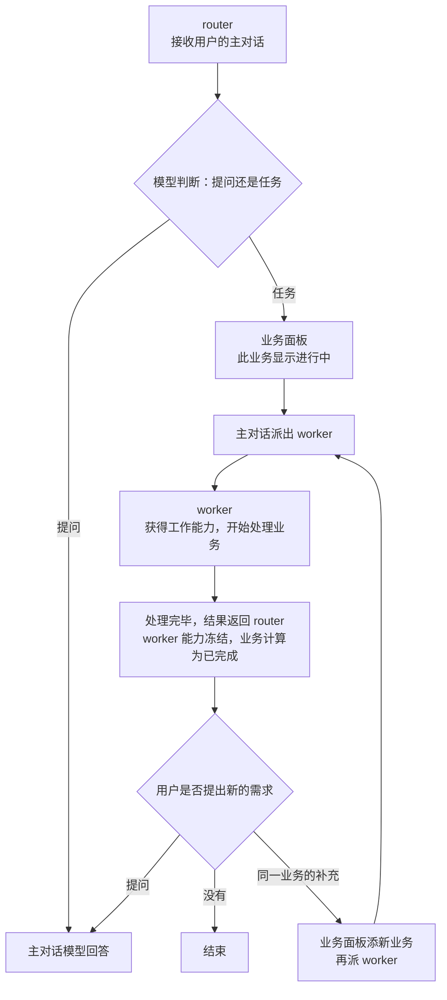

# Diagram 001: terms and main flow

Raw reference diagram supplied by the user. It fixes the terminology and the router-to-worker flow; [001 Domain model](../001-domain.md), [002 Rules](../002-rules.md), [003 Lifecycle](../003-lifecycle.md) and [005 Panel](../005-panel.md) follow it, and any difference is named in [001 Domain model: Diagram alignment](../001-domain.md#图表对齐).

## Terms

| Term | Meaning |
| --- | --- |
| router | The main conversation that receives the user. It decides question or task and owns the project split. |
| worker | A new conversation started for one task, with its own work capability. |
| team | Several workers form one team. One project is normally managed by one team; different projects are separated by the router. |

## Rules carried by the diagram

- The router handles a “call worker” tool every turn. It may decide not to call a worker, but it must say why.
- A question is answered by the router.
- A task is added to the business panel as in progress, then the router dispatches a worker.
- When the worker finishes, the result returns to the router; the worker capability freezes and the business is counted as completed.
- A new requirement is either a same-business supplement (add a business row and dispatch a worker again) or a question (back to the router).

## Raw description (as supplied)

> 术语：接收用户的主对话叫 router；执行任务的新对话叫 worker；若干 worker 组成一个团队。一般一个项目由一个团队管理；出现不同项目就应分开，这就是 router 的职责。
>
> router 每轮对话都要处理一个「调用 worker」的工具，router 可以不调用，但要写明为什么。
>
> 流程：接收用户问题 → 模型判断是提问还是任务。提问 → 主对话模型回答；任务 → 加入业务面板 → 主对话派出 worker（业务面板此业务显示为进行中）→ worker 获得工作能力、开始处理业务 → 处理完毕把结果返回 router，同时 worker 能力被冻结、业务计算为已完成 → 判断用户是否提出新的需求：没有则结束；有新需求则主对话判断是否为同一业务的补充，是则业务面板添新业务再派 worker，不是提问则循环，是提问则回到主对话回答。
