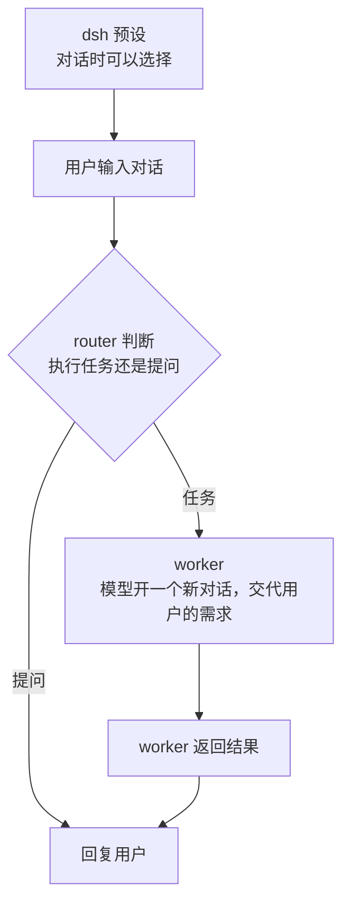

# Diagram 002: preset flow

Raw reference diagram supplied by the user. It is the short form of [diagram 001](001-terms-and-flow.md); the implementation uses the `superagent-lite` preset as the router and the `superagent-lite-worker` preset as the worker.

## Rules carried by the diagram

- DSH provides a preset; a conversation may use it.
- The router decides whether an input is a task or a question.
- A question is answered directly.
- An executable task is handed to a worker through a new conversation carrying the user's requirement.
- The worker returns the result to the router, and the router replies to the user.

## Raw description (as supplied)

> dsh 提供一个预设，对话时可以使用；用户输入对话后 router 判断是执行任务还是提问；提问直接回答；可执行的任务交给 worker（模型开一个新对话，交代用户的需求），对话传来结果后回复用户。
