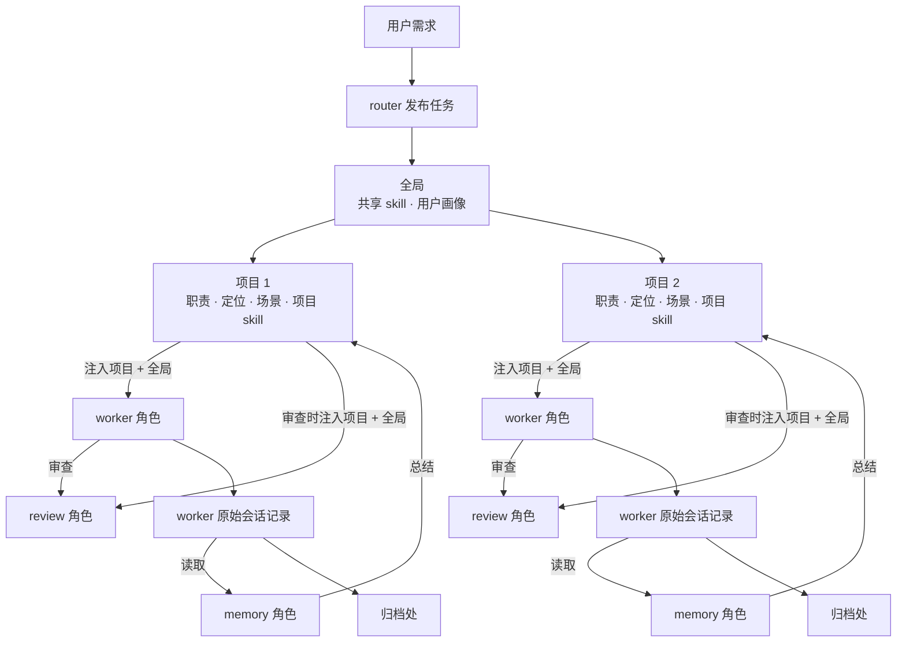

# Diagram 003: memory system

Raw reference diagram supplied by the user (`tmp/新记忆模块.png`). It is preserved here as the source for the memory design; [001 Domain model](../001-domain.md), [002 Rules](../002-rules.md), [003 Lifecycle](../003-lifecycle.md), [006 Deployment](../006-deployment.md) and [007 Architecture](../007-architecture.md) implement and explain it.

## Rules carried by the diagram

| Part | Meaning |
| --- | --- |
| Global layer | Shared by every project: `sharedSkill` and `userProfile`. |
| Project layer | Separate for each project: `responsibilities`, `positioning`, `scenarios` and a `skill` summarized for the project and its responsibilities. |
| Prompt injection | A worker and a reviewer both receive the project layer plus the global layer. |
| Raw conversation | The worker's original conversation is retained and archived. |
| Memory role | The `memory` role reads the raw worker conversation and summarizes the result back into the project layer. |

## Implementation mapping

| Diagram part | Code |
| --- | --- |
| Global memory | `memory/global.json`, fields `userProfile` and `sharedSkill` (`src/memory-store.js`) |
| Project memory | `memory/projects/<sha256(projectRoot)>.json`, fields `responsibilities`, `positioning`, `scenarios`, `skill` (`src/memory-store.js`) |
| Worker injection | `registerMemoryContext` reads project + global memory at Worker creation, order `170`, required context (`src/memory.js`, `index.js`) |
| Reviewer injection | `memoryPromptForProject` is added to the review prompt on every review (`src/review.js`) |
| Router injection | `registerGlobalMemoryContext` injects only the global layer (`router.js`) |
| Raw conversation | `workerConversation` builds the transcript from the worker Session (`src/memory.js`) |
| Memory role | `memoryRole` / `memoryPrompt`, label `Distill memory`, depth 2, read-only helper (`src/memory.js`) |
| Summary write | `runMemoryExtraction` writes only non-empty changed fields (`src/memory.js`) |
| Archive | `archiveWorkerTurn` writes each turn under `memory/archive/` (`src/memory.js`, `src/memory-store.js`) |

## Raw description (as supplied)

> 用户需求 → router 发布任务 → 全局（共享 skill、用户画像）→ 项目 1 / 项目 2。
>
> 项目级的记忆分开，全局的记忆共享；提示词注入时应该为项目级 + 全局都注入。
>
> 项目记忆包含职责、定位、场景，以及总结出来、适用于当前项目与职责的 skill。
>
> worker 角色和 review 角色都注入职责、定位、场景、skill 的 description；review 由 worker 触发审查。
>
> worker 原始会话记录同时进入归档处和 memory 角色；memory 角色总结后写回项目记忆。
