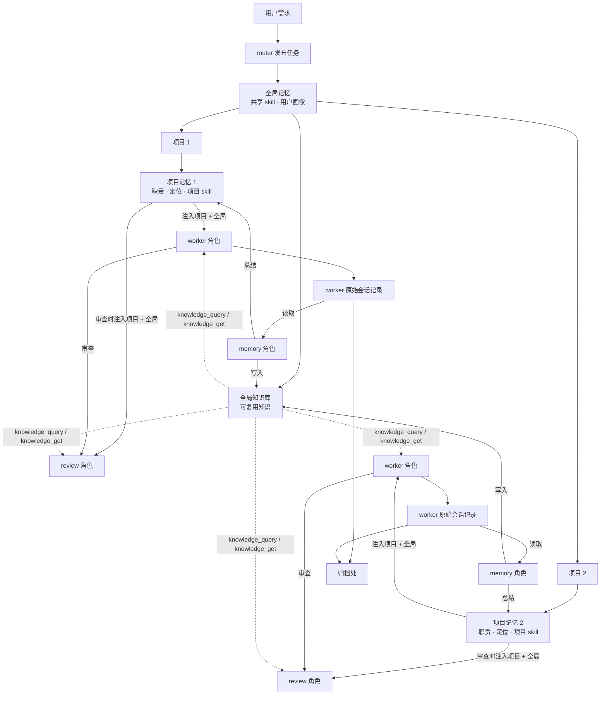

# Diagram 003: memory system

Raw reference diagram supplied by the user (`tmp/新记忆模块.drawio.png`). It is preserved here as the source for the memory design; [001 Domain model](../001-domain.md), [002 Rules](../002-rules.md), [003 Lifecycle](../003-lifecycle.md), [004 Configuration](../004-config-prompts.md), [006 Deployment](../006-deployment.md) and [007 Architecture](../007-architecture.md) implement and explain it.

## Rules carried by the diagram

| Part | Meaning |
| --- | --- |
| Global layer | Shared by every project: one shared skill, the user profile, and the global knowledge base. |
| Project layer | Separate for each project: responsibilities, positioning, and up to 10 memory-registered project skills. |
| Router injection | Only the global layer's memory. |
| Worker and reviewer injection | The project layer plus global memory. Responsibilities and positioning are injected directly. |
| Skills | Stored as normal skill files; only their descriptions enter the skill catalog, and the full body loads only through the `skill` tool. A skill holds a reusable fixed procedure or method only; knowledge, facts, experience, and conclusions go to the knowledge base. A project keeps at most 10 skills; at the cap memory may only update an existing memory-managed name, and a rejected batch writes no field or skill. |
| Knowledge base | Global and reached only through the query, read, and write tools; only the memory role may use the write tool, and its content is never injected. It stores knowledge, facts, experience, conclusions, and observations, not procedures. |
| Raw conversation | The worker's original conversation is retained and archived. |
| Memory role | The `memory` role receives the readable session-record path plus task, role, and branch metadata, the current project skill count (out of 10), reads the record itself, summarizes it, and writes the project layer, global memory, and global knowledge base. |

## Implementation mapping

| Diagram part | Code |
| --- | --- |
| Global memory | `memory/global.json`, field `userProfile` (`src/memory-store.js`) |
| Project memory | `memory/projects/<sha256(projectRoot)>.json`, fields `responsibilities` and `positioning` (`src/memory-store.js`) |
| Shared skill | `~/.agents/skills/<skillName>/SKILL.md` with `author: memory`; one directory per skill, description only in the skill catalog; the legacy `superagent-shared-memory` keeps working |
| Project skill | `<projectRoot>/.dsh/skills/<skillName>/SKILL.md` with `author: memory`; at most 10 per project, and a new name is rejected at the cap while an existing memory-managed name can still be updated. A worker-scoped provider reads the memory-managed project skills from the project checkout so the Worktree worker and reviewer see their descriptions in the skill catalog. Skill files are the ownership record: new, edited, or deleted skills authored by memory do not hot-update a published catalog; a missing author is treated as an ordinary skill. The legacy `superagent-project-memory` keeps working |
| Knowledge base | `memory/knowledge.json`, queried and edited through `knowledge_query`, `knowledge_get`, and `knowledge_write` (`src/memory-store.js`, `src/memory.js`) |
| Router injection | `refreshGlobalMemory` / `registerGlobalMemoryContext` (`src/memory.js`, `router.js`) |
| Worker injection | `registerMemoryContext` reads project + global memory at Worker creation (`src/memory.js`, `index.js`) |
| Reviewer injection | `memoryPromptForProject` is added to the review prompt on every review (`src/memory.js`, `src/review.js`) |
| Raw conversation | `workerConversation` builds the transcript, `writeSessionRecord` writes it to `task/archive/sessions/<sha256(Session ID)>.md` (`src/memory.js`, `src/memory-store.js`) |
| Memory role | `memoryRole` / `memoryPrompt`, label `Distill memory`, depth 2, read-only helper with the knowledge query, read, and write tools; the prompt carries the record path and task, role, and branch metadata but not the conversation body (`src/memory.js`, `index.js`) |
| Summary write | `runMemoryExtraction` writes only non-empty changed fields and changed skills, in bulk per scope; project skills are written first so an over-cap batch rejects before any field or shared skill is written (`src/memory.js`, `src/memory-store.js`) |
| Archive | `archiveWorkerTurn` writes each turn under `task/archive/`; `runMemoryExtraction` writes the session record under `task/archive/sessions/` (`src/memory.js`, `src/memory-store.js`) |

## Rules

- Global memory is shared by every project; project memory and the project skill are keyed by the normalized project root and never cross projects. The knowledge base is global too.
- Router sees only global memory. The router preset restricts its skill roots to the global skill roots; the worker preset keeps project and global skill roots.
- Worker and reviewer prompts receive the project and global memory text. Responsibilities and positioning are injected directly; skills only contribute their descriptions to the catalog. Knowledge base content is never injected.
- A running or finished session keeps the catalog it published: catalog changes caused only by memory-owned skills are withheld, and changes involving any other skill are delivered. The decision follows the live agent and skill author, never the Task status, so running, BLOCKED, resuming and awaiting-merge sessions are covered alike.
- The memory role may read and write memory. It writes no duplicate facts, writes nothing when nothing is reusable, and corrects a wrong entry when the conversation supports the correction; the number of written entries is not a goal. A project keeps at most 10 skills; at the cap it reuses an existing memory-managed project skill name, and an over-cap write is rejected without partial state.
- Knowledge and skills are separated: knowledge, facts, experience, conclusions, and observations go to the global knowledge base, while a skill holds only a reusable fixed procedure or method.
- The knowledge base is tool-only: `knowledge_query` (keyword search with numbered context snippets) and `knowledge_get` (full entries by id) are available to workers, reviewers, and the memory role; `knowledge_write` is available only to the memory role.
- Memory is data, not instructions; it cannot add a requirement or grant permission.
- Storage follows "prefer less over more, long-term": durable facts only, never transient progress, status, counts, credentials, or personal data. Useless knowledge pollutes the global knowledge base, so omitting it is better.
