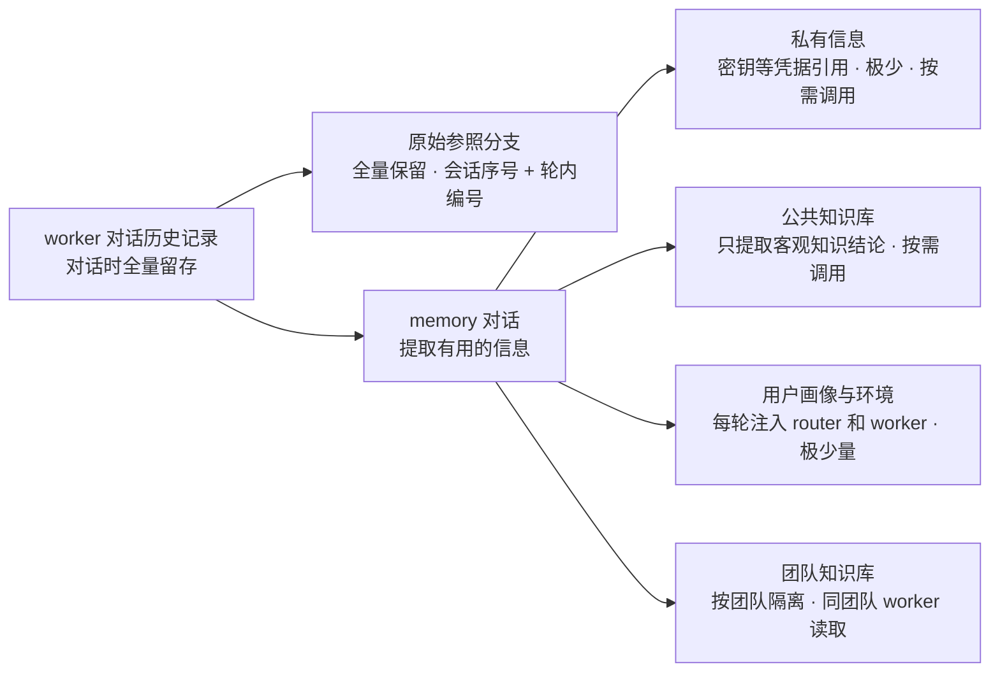

# Diagram 003: memory system

Raw reference diagram supplied by the user. It is preserved here as the source for the memory design; [001 Domain model](../001-domain.md), [002 Rules](../002-rules.md), [003 Lifecycle](../003-lifecycle.md), [005 Panel](../005-panel.md) and [007 Architecture](../007-architecture.md) implement and explain it.

## Rules carried by the diagram

| Branch | Meaning |
| --- | --- |
| Raw reference | The worker conversation is retained in full, with the Session sequence and a per-turn reference number for later consultation. |
| Main line | The memory conversation extracts only useful information and writes it into the memory system. |
| Private | Credential references, never secret values; extremely rare and read on demand. |
| Public | Objective knowledge and conclusions only; read on demand. |
| User profile and environment | Injected as context into every router and worker chat; extremely small. |
| Team | Isolated by team and project; only a worker of the same team and project reads it. |

## Implementation mapping

| Diagram part | Code |
| --- | --- |
| Raw reference | `archiveWorkerTurn` in `src/memory.js`, records under `memory/archive/`, with an event sequence and per-turn `reference` numbers |
| Memory conversation | `src/memory-extractor.js`, role label `Distill memory`; reads the worker Session transcript through `workerConversation` in `src/memory.js` |
| Four categories | `memoryExtractorPrompt` and `memoryFacts` in `src/memory.js`; records in `private`, `public`, `profile`, `team` |
| On-demand reads | `superagent_memory` with `action=list/read`, one call at a time |
| Every-chat injection | `refreshProfile` and `registerProfileContext`, runtime context order `170`, newest 6 facts cut to 500 characters |
| Team isolation | `scopeOf` in `src/memory-store.js`; team callers need both Team and Project |

## Raw description (as supplied)

> 流程：worker 对话历史记录 → 一条分支「全量保留，作为原始参照物，做好编号标记」；主线是「memory 提取其中有用的信息」→ 写入「记忆系统」。
>
> 记忆系统分四类，各自约束：
> 1. 私有信息：如密钥等，应该极少，按需调用。
> 2. 公共知识库：只提取客观意义上的知识，应该只记结论，按需调用。
> 3. 用户画像与环境：每次聊天都作为上下文注入给 router 和 worker，也属于极少量范围。
> 4. 团队知识库：按团队隔离，只有同团队的 worker 才能读取。
